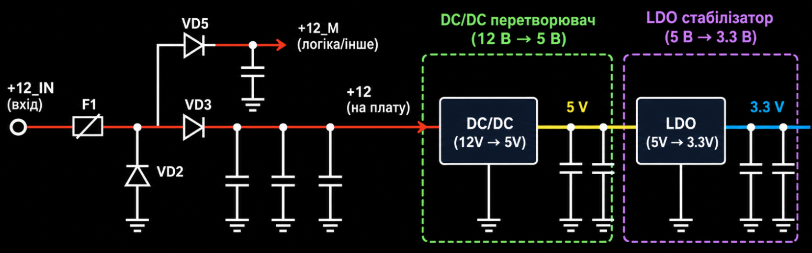
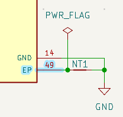
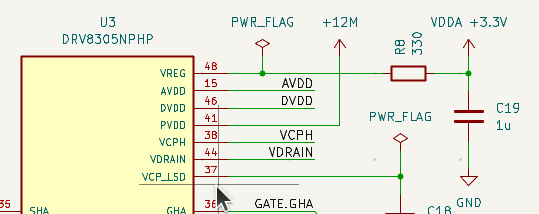
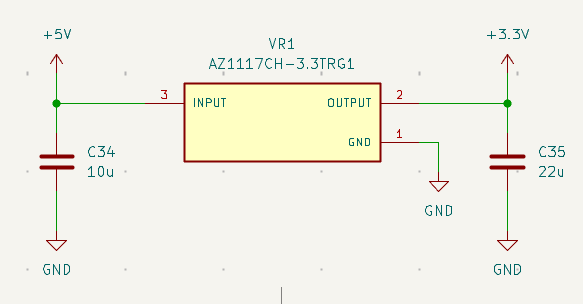
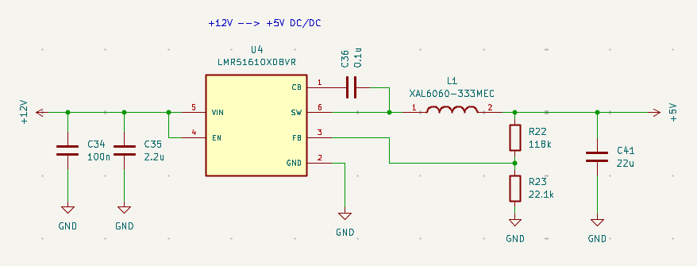
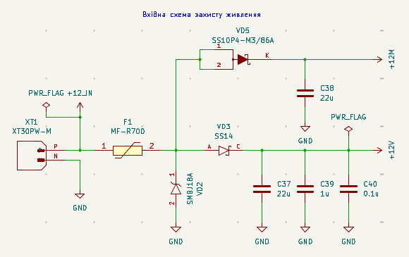
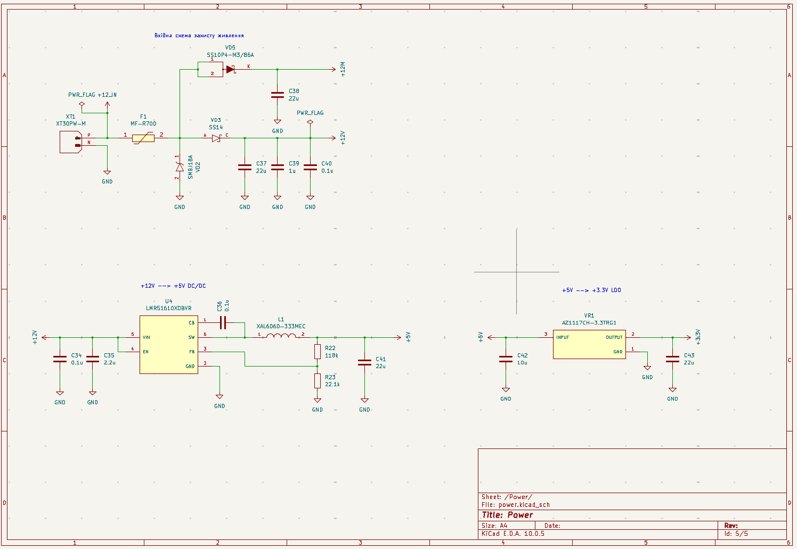

# Заняття 10: Джерела живлення. Частина 1

## Опис завдання

Зібрати схему живлення ланцюгів моторного контролера з вхідним живленням **+12_IN** відповідно до заданої архітектури.
Допускаємо, що живлення **+12_IN** приходить на роз'єм.

**Архітектура схеми:**



- **12_IN** — вхідна напруга;
- **12_M** — живлення двигуна і драйвера ключів;
- **5V** — живлення датчиків Холла;
- **3.3V** — живлення логіки.

1\. Підготуйте компоненти для схеми:

- імпортуйте VD5 (SK54 або аналог);
- імпортуйте VD3 (SS14 або аналог);
- імпортуйте роз'єм живлення XT30;
- підберіть та імпортуйте самовідновлюваний полімерний запобіжник PolySwitch (F1): максимальна робоча напруга 15–16 V, струм утримання 5 A;
- підберіть та імпортуйте супресор TVS (ESD Protection Diodes / TVS Diode) для захисту від імпульсних перенапруг шини 12 V під час гальмування двигуна тощо: однонаправлений, робоча stand-off напруга 17–18 V, піковий струм 20–21 A.

2\. Підберіть DC/DC-перетворювач 12/5 V з вихідним струмом 1 A або трохи більше.

3\. Підберіть LDO з вихідною напругою 3.3 V, виходячи з таблиці нижче. Запас по струму — мінімум 2 рази.

4\. Складіть схему в KiCad.

Приблизне споживання компонентів на платі (з даташитів):

| Споживач | Орієнтовне споживання |
|---|---|
| STM32F407 | 40–80 mA із запасом |
| 3 × Hall sensor (5V) | ~15–30 mA із запасом (живлення від 5V) |
| DRV8305 | живлення від 12V |
| LED, pull-up, інша логіка | 20–50 mA |
| BLE, наприклад RN4870/71, якщо використовується | 10–13 mA |

## Рішення завдання

### 0. Додаткові елементи схеми

- Виправив зауваження для драйвера DRV8305NPHP (Both GND and EP are attached to the same items; GND will be
used in the netlist). З'єднав землю та вихід EP через елемент Net_Tie_2. Крім того вихід EP позначений як
Electrical Type = "Power input", то для нього потрібно додати елемент PWR_FLAG:



- При отриманні інформації про споживання DRV8305NPHP від +3.3V через вхід VREG виявив, що згідно даташиту
(8.2.3 VREG Reference Voltage Input (DRV8305N)), потрібно обмежити струм що йде на вхід VREG до 50 мА
через наявність в середині мікросхеми діоду від VREG до PVDD. Якщо на PVDD напруга буде менше за VREG
то струм потече в PVDD. Для обмеження по струму додаю новий резистор R8 номіналом 330 Ом:



### 1. LDO +3.3V

Згідно схеми напругу +3.3V споживають MCU (STM32F405RGT6) та додаткова логіка - резистори підтяжок pull-up,
інша дрібна логіка на +3.3V. У таблиці завдання наведено STM32F407, на платі стоїть STM32F405 того ж сімейства
без Ethernet/DCMI, тому бюджет 40–80 mA для нього теж підходить (із запасом). За даташитом DRV8305 струм, що втікає в VREG, становить ≤ 100 µA
("Externally applied reference sink current (VREG)"), тому ним можна знехтувати.
Тоді сумарне споживання буде дорівнювати:

$$I_{3.3V} = I_{MCU} + I_{logic} = (40\ldots80) + (20\ldots50) = 60\ldots130\ \text{mA}$$

З запасом мінімум ×2:

$$I_{LDO} \geq 2 \cdot 130 \approx 260\ \text{mA} \Rightarrow \text{LDO на} \geq 300\ \text{mA}$$

Потужність, що розсіюється на LDO:

$$P_{LDO} = (V_{IN} - V_{OUT}) \cdot I_{OUT} = (5 - 3.3) \cdot 0.13 \approx 0.22\ \text{W}$$

Обрано: **Diodes AZ1117CH-3.3TRG1** - фіксовані 3.3 V, I<sub>OUT</sub> = 0.8 A (параметри в даташиті нормовані для 0.8 A; обмеження струму 1 A min / 1.35 A typ), V<sub>IN</sub> до 18 V, стабільний з керамічними конденсаторами, корпус SOT-223.
Даташит: [Diodes AZ1117C](https://www.diodes.com/assets/Datasheets/AZ1117C.pdf)

Чому саме він:
- 0.8 A ≥ 2 × 130 mA - запас 0.8 / 0.13 ≈ 6 разів;
- запас на падіння: $V_{IN} - V_{OUT} = 1.7\ \text{V}$. $V_{DROP}$ max = 1.3 V для SOT-223 (при 0.8 A). Тоді 1.7 V > 1.3 V, тобто запас є; 
- SOT-223 з контактною площадкою на виводі TAB легко розсіює 0.22 W (тепловий опір без радіатора дорівнює $θ_{JA} = 125^\circ\text{C/W}$,
максимальна робоча температура кристала $125^\circ\text{C}$, при температурі навколишнього середовища $T_{A} = +40^\circ\text{C}\ $
(беремо із запасом на літо), розраховуємо температуру всередині мікросхеми: $T_{J}
 = T_{A} + P_{LDO} × θ_{JA} = 40^\circ\text{C} + 0.22 \text{Вт} × 125^\circ\text{C/W} = 40^\circ\text{C} + 27.5^\circ\text{C} = 67.5^\circ\text{C}$, що менше ніж $125^\circ\text{C}$);
- стабільний з керамікою: не потрібні танталові конденсатори (модифікація AZ1117C - це оновлений чіп,
який вміє стабільно працювати із сучасною дешевою керамікою).

Обв'язка: вхід 10 µF, вихід 22 µF.



### 2. DC/DC-перетворювач 12 → 5 V

Навантаження шини 5V: датчики Холла (до 30 mA) + вхід LDO (струм шини 3.3V до 130 mA, див. п. 1, плюс власний
струм LDO $I_{Q} \approx 5\ \text{mA}$):

$$I_{5V} \approx 30 + 130 + 5 = 165\ \text{mA}$$

Обрано: **TI LMR51610XDBVR** (LCSC C20539658) - синхронний buck, $V_{IN} = 4.5 - 65 \text{V}, I_{OUT} = 1 \text{A}, f_{SW} = 400 \text{kHz}$, PFM на малому навантаженні, $I_{Q} = 25 \text{µA}$, корпус SOT-23-6.
Даташит: [PDF](https://www.ti.com/lit/ds/symlink/lmr51610.pdf)

Чому саме він:
- 1 A на виході, як і вимагає завдання; запас по струму 1 / 0.165 ≈ 6 разів;
- вхід до 65 V;
- синхронний, із вбудованими ключами: не потрібен зовнішній діод, мінімум обв'язки;
- PFM - висока ефективність при реальному навантаженні ~165 mA.

Обв'язка (типова схема з даташита):

- $C_{IN} = 2.2\ \text{µF / 50 V}$ (X7R, вхід VIN, EN);
- $C_{OUT} = 22\ \text{µF / 25 V}$ (X7R).
- $R_{FBT} = 118\ \text{k}$;
- $R_{FBB} = 22.1\ \text{k}$;
- перевіряємо дільник зворотного зв'язку ($V_{FB} = 0.8\ \text{V}$): $V_{OUT} = 0.8 \cdot \left(1 + \frac{R_{FBT}}{R_{FBB}}\right) = 0.8 \cdot \left(1 + \frac{118\ \text{k}}{22.1\ \text{k}}\right) \approx 5.07\ \text{V}$;
- дросель $L_{OUT} =33\ \mu\text{H}$;
- C<sub>BOOT</sub> = 100 nF (між CB і SW);
- Додаю конденсатор 100 nF на вхід DC/DC. Даташит (8.2.2.6) прямо вимагає: «Include a capacitor with a value of 0.1 µF for high-frequency filtering».
  Його треба поставити якомога ближче до виводів VIN/GND.

**Вибір дроселя.**

Обрано: **Coilcraft XAL6060-333MEC** - 33 µH ±20 %, I<sub>sat</sub> = 3.7 A (спад L на 30 %), I<sub>RMS</sub> = 2.7 A (нагрів +20 °C),
DCR ≤ 105 mΩ, литий екранований, 6 × 6 мм.
Даташит: [Coilcraft XAL6060-333](https://www.coilcraft.com/en-us/products/power/shielded-inductors/molded-inductor/xal/xal60xx/xal6060-333/)

Чому саме він:
- I<sub>sat</sub> = 3.7 A > 1.95 A - запас ≈ 1.9 раза, дросель не насичується навіть при КЗ на виході;
- I<sub>RMS</sub> = 2.7 A > 1 A - запас по нагріву для максимального струму перетворювача;
- втрати на DCR (Direct Current Resistance) при реальному навантаженні мізерні: $P = I^2 \cdot DCR = 0.165^2 \cdot 0.105 \approx 2.9\ \text{mW}$;
- литий (molded) дросель має м'яке насичення та мале поле розсіювання - менше наводок на аналогові кола вимірювання струму;
- 6 × 6 мм - компактний для струму 1 A.



### 3. Компоненти вхідного кола

Розраховуємо струм на вході +12_IN:

- +12M - струм, що споживає двигун $I_{M} = 5 \text{А}$ (60 W при 12 V; двигун замінено на менш потужний, замість 14 А з ДЗ 6);
- +12M - драйвер DRV8305 (вивід PVDD живиться від силової шини +12M разом з інвертором):
  - Власний струм драйвера $I_{PVDD\_Operating} = 15 \text{mA}$;

    Розрахуємо динамічний струм затворів $I_{dyn}$:

    Згідно з технічною документацією AOD4184A Datasheet, повний заряд затвору $Q_{g}$ для MOSFET транзистора AOD4184A при напрузі керування $V_{GS} = 10\text{ В}$ становить:
    - Типове значення: $27\text{ нКл}$
    - Максимальне значення: $33\text{ нКл}$ AOD4184A

    Підставимо ці дані у формулу для 6 транзисторів (3-фазний міст) та частоти ШІМ $20\text{ кГц}$:
    - Типовий динамічний струм:
    $I_{dyn\_typ}=6\cdot 27\text{ нКл}\cdot 20\text{ кГц}=6\cdot (27\cdot 10^{-9}\text{ Кл})\cdot 20000\text{ Гц}\approx \mathbf{3.24}\text{ мА}$
    - Максимальний динамічний струм:
    $I_{dyn\_max}=6\cdot 33\text{ нКл}\cdot 20\text{ кГц}=6\cdot (33\cdot 10^{-9}\text{ Кл})\cdot 20000\text{ Гц}\approx \mathbf{3.96}\text{ мА}$

    Сумарне споживання від 12 В (PVDD):

    Додаємо отримане значення до власного струму споживання драйвера в активному стані:
    - Загальний струм: $I_{DRIVER} = 15\text{ мА} + 4\text{ мА} = 19\text{ мА}$ (максимальний).

  Сумарно струм шини +12M: $I_{12M} = I_{M} + I_{DRIVER} = 5 + 0.019 \approx 5.02\text{ А}$
- +12V (на плату) - живить тільки DC/DC-перетворювач, а LDO вже стоїть після нього на шині +5V:
  - Навантаження +5V (див. п. 2): $I_{5V} = 30 + 130 + 5 = 165\text{ мА}$ (датчики Холла + шина 3.3V + власний струм LDO $I_{Q}$
    з даташиту AZ1117C, типово $5\text{ мА}$);
  - Вхідний струм DC/DC при ККД $\eta \approx 0.85$:

    $I_{12V} = \frac{V_{5V} \cdot I_{5V}}{V_{12V} \cdot \eta} = \frac{5 \cdot 0.165}{12 \cdot 0.85} \approx 81\text{ мА}$

Сумарно струм на вході +12_IN буде дорівнювати: $I_{12\_IN} = I_{12M} + I_{12V} = 5.019 + 0.081 = 5.1\text{ А}$

| Позиція | Компонент | Ключові параметри | Корпус | Даташит |
|---|---|---|---|---|
| XT1 | Amass XT30PW-M (LCSC C431092) | 2 контакти, 15 A тривало / 30 A імпульсно, 500 V DC | THT, кутовий, на плату | [LCSC](https://www.lcsc.com/datasheet/C431092.pdf) |
| F1 | Bourns MF-R700 | PTC, V<sub>max</sub> = 30 V, I<sub>hold</sub> = 7 A, I<sub>trip</sub> = 14 A, I<sub>max</sub> = 40 A, R<sub>min</sub> = 5 mΩ | радіальний THT | [Bourns MF-R](https://www.bourns.com/docs/product-datasheets/mf-r.pdf) |
| VD2 | Littelfuse SMBJ18A | однонаправлений, 600 W, V<sub>RWM</sub> = 18 V, V<sub>BR</sub> ≥ 20 V, V<sub>C</sub> = 29.2 V, I<sub>PP</sub> = 20.6 A | SMB (DO-214AA) | [SMBJ](https://datasheet.lcsc.com/lcsc/2304140030_Littelfuse-SMBJ18A_C151256.pdf) |
| VD3 | SS14 | Шотткі, 40 V, 1 A, V<sub>F</sub> ≈ 0.5 V @ 1 A | SMA (DO-214AC) | [DigiKey](https://www.digikey.com/en/products/detail/onsemi/SS14/965729) |
| VD5 | Vishay SS10P4-M3/86A | Шотткі, 40 V, 10 A, V<sub>F</sub> = 0.41 V typ @ 5 A, 0.56 V max @ 10 A, R<sub>θJL</sub> = 3 °C/W | TO-277A (SMPC) | [Vishay SS10P4](https://www.vishay.com/docs/88983/ss10p4.pdf) |

**Струм через вхідне коло.** Через XT1 та F1 проходить увесь вхідний струм $I_{12\_IN} \approx 5.1\ \text{A}$
(двигун з драйвером ≈ 5.02 A + плата ≈ 0.08 A). Через VD5 іде струм шини +12M ≈ 5 A, через VD3 - лише вхідний струм DC/DC ≈ 0.08 A.

**XT1.** XT30PW-M розрахований на 15 A тривало - запас 15 / 5.1 ≈ 3 рази; короткочасні піки до 30 A роз'єм теж витримує.

**F1.** Початково за умовою завдання було підібрано Littelfuse 2920L500/16 (I<sub>hold</sub> = 5 A, V<sub>max</sub> = 16 V),
але вхідний струм 5.1 A більший за його I<sub>hold</sub>. До того ж I<sub>hold</sub> нормований при +23 °C і з нагрівом
зменшується, тому запобіжник спрацьовував би при нормальній роботі. Замінено на **Bourns MF-R700**:
- I<sub>hold</sub> = 7 A - запас 7 / 5.1 ≈ 1.4 раза при +23 °C. З нагрівом I<sub>hold</sub> зменшується
  (таблиця Thermal Derating даташита MF-R): 5.81 A при +40 °C (запас ≈ 1.14) і 5.39 A при +50 °C (≈ 1.06).
  Тобто при T<sub>A</sub> = 40 °C (як у п. 1) запобіжник тримає струм, але запас невеликий - F1 треба розмістити
  подалі від VD5 і силових ключів, щоб він не підгрівався від них;
- I<sub>trip</sub> = 14 A - при КЗ або заклинюванні двигуна запобіжник гарантовано розмикається і після охолодження
  відновлюється сам;
- V<sub>max</sub> = 30 V > 16 V з умови - більша робоча напруга лише додає запасу;
- R = 5…20 mΩ (R<sub>1max</sub> = 30 mΩ після спрацювання): втрати при 5.1 A від $5.1^2 \cdot 0.005 \approx 0.13\ \text{W}$
  до $5.1^2 \cdot 0.02 \approx 0.52\ \text{W}$.

Корпус радіальний (THT), як і в роз'єму XT30, тому окремих вимог до монтажу немає.

**VD2.** SMBJ18A відповідає всім трьом вимогам: однонаправлений, V<sub>RWM</sub> = 18 V (17–18 V), I<sub>PP</sub> = 20.6 A (20–21 A).
Номінал 12 V (навіть з допуском +10 %, 13.2 V) нижчий за V<sub>RWM</sub>, тому в робочому режимі струм витоку TVS мізерний.
Під час гальмування двигуна напруга на шині обмежується до ≤ 29.2 V, а це нижче за максимальну вхідну напругу DC/DC (65 V),
робочу напругу PVDD драйвера DRV8305 (до 45 V) і зворотну напругу VD3/VD5 (40 V).

**VD3/VD5.** Шотткі-діоди захищають від переполюсовки та розв'язують шини: VD5 живить силову шину +12_M, VD3 - шину плати +12.
Тоді зворотний струм від двигуна при гальмуванні не потрапляє на живлення логіки, а конденсатори +12 тримають напругу під час просадок на +12_M.
- VD3: реальний струм ≈ 0.08 A; навіть при повному навантаженні DC/DC 1 A він становить $I \approx \frac{5 \cdot 1}{12 \cdot 0.9} \approx 0.46\ \text{A}$ < 1 A.
- VD5: замість SK54 (5 A - без запасу, V<sub>F</sub> ≈ 0.55 V, ≈ 2.75 W у корпусі SMC) обрано **Vishay SS10P4**:
  - I<sub>F</sub> = 10 A - запас по струму 2 рази;
  - V<sub>F</sub> = 0.41 V typ при 5 A - втрати $P = V_{F} \cdot I_{M} = 0.41 \cdot 5 \approx 2.1\ \text{W}$, на ≈ 25 % менше, ніж у SK54;
  - V<sub>RRM</sub> = 40 V > 29.2 V (напруга обмеження TVS);
  - корпус TO-277A має великий катодний вивід-тепловідвід: R<sub>θJL</sub> = 3 °C/W. Тепло з кристала майже без опору
    переходить на мідь плати, тому під катодом потрібен полігон міді на обох шарах з перехідними отворами.
    Без нього (R<sub>θJA</sub> ≈ 60 °C/W на мінімальних площадках) 2.1 W нагріли б кристал на ≈ 125 °C.

**Висновок по вхідному колу.** Для двигуна 5 A (вхідний струм ≈ 5.1 A) усі компоненти мають запас по струму:
XT1 - ≈ 3 рази, F1 - ≈ 1.4 раза при +23 °C (≈ 1.14 при +40 °C), VD5 - 2 рази, VD2 і VD3 - з великим запасом.
F1 і VD5 замінено порівняно з параметрами з умови (5 A), бо при струмі 5.1 A вони працювали б без запасу.
Найбільше тепла (≈ 2.1 W) виділяється на VD5 - його потрібно розмістити на полігоні міді.
Якщо втрати на діоді будуть завеликими, VD5 можна замінити ідеальним діодом (контролер, наприклад LM74700, + MOSFET):
падіння напруги впаде з 0.41 V до кількох десятків мілівольт.



### 4. Схема в KiCad

До проєкту додано новий ієрархічний аркуш **Power** (`power.kicad_sch`, сторінка 5/5). Він складається з трьох блоків:

1. **Вхідна схема захисту живлення.** Роз'єм XT1 (XT30PW-M) → F1 (MF-R700) → далі дві гілки:
   - через VD5 (SS10P4-M3/86A) на силову шину **+12M** (інвертор, PVDD драйвера); C38 22 µF;
   - через VD3 (SS14) на шину плати **+12V**; C37 22 µF, C39 1 µF, C40 100 nF.

   TVS VD2 (SMBJ18A) стоїть одразу після F1, перед діодами розв'язки.
2. **DC/DC +12V → +5V**: U4 LMR51610XDBVR.
   - Вхід: C34 100 nF (ВЧ) і C35 2.2 µF (1206).
   - C36 0.1 µF - bootstrap CB–SW.
   - L1 XAL6060-333MEC 33 µH.
   - Дільник R22 118k / R23 22.1k.
   - Вихід: C41 22 µF (1210).
   - EN підключено до VIN.
3. **LDO +5V → +3.3V**: VR1 AZ1117CH-3.3TRG1, на вході C42 10 µF (1206), на виході C43 22 µF (0805).

**Зв'язок з ієрархією.** Аркуш Power не має ієрархічних пінів. Живлення передається на інші аркуші глобальними
power-символами:

| Мережа | Звідки | Куди |
|---|---|---|
| +12M | Power (VD5) | Gate Driver, Inverter |
| +12V | Power (VD3) | Power (вхід DC/DC U4) |
| +5V | Power (U4) | MCU, Gate Driver |
| +3.3V | Power (VR1) | MCU, Gate Driver, Inverter |

PWR_FLAG стоїть на мережах +12_IN і +12V. Вони позначають для ERC джерела живлення, бо роз'єм і діоди мають пасивні виводи.

Для всіх імпортованих компонентів (XT1, F1, VD2, VD3, U4, L1, VR1) додано власні бібліотеки символів і посадкових місць
у `lib/parts/`. VD5 використовує стандартний символ `Device:D_Schottky` з футпринтом `Package_TO_SOT_SMD:TO-277A`.



Файли: [`power.kicad_sch`](../../motor-drive-controller/hardware/kicad/power.kicad_sch)

## Результат

ERC всієї схеми (`kicad-cli sch erc`) - **0 помилок, 0 попереджень**:

```text
***** Sheet /Power/

 ** ERC messages: 0  Errors 0  Warnings 0
```

**Висновок.** Спроєктовано схему живлення контролера двигуна: вхід 12 V → захист → шини +12M / +12V → 5 V (DC/DC) → 3.3 V (LDO).

| Вузол | Компонент | Навантаження | Можливість | Запас |
|---|---|---|---|---|
| Роз'єм | XT30PW-M | 5.1 A | 15 A | ≈ 3× |
| Запобіжник | MF-R700 | 5.1 A | I<sub>hold</sub> 7 A, I<sub>trip</sub> 14 A | ≈ 1.4× (≈ 1.14× при +40 °C) |
| TVS | SMBJ18A | 12 V (13.2 V max) | V<sub>RWM</sub> 18 V, V<sub>C</sub> 29.2 V | - |
| Діод +12M | SS10P4 | 5 A | 10 A / 40 V | 2× |
| Діод +12V | SS14 | ≈ 0.08 A | 1 A / 40 V | ≈ 12× |
| DC/DC 5 V | LMR51610 | ≈ 0.17 A | 1 A, V<sub>IN</sub> до 65 V | ≈ 6× |
| LDO 3.3 V | AZ1117C | ≤ 130 mA | 0.8 A | ≈ 6× |

Усі елементи працюють із запасом по струму й напрузі. Вхідна напруга обмежується TVS до 29.2 V, а це нижче
за допустимі напруги діодів (40 V), DC/DC (65 V) і DRV8305 (45 V).

Найбільші втрати мають:
- VD5 (SS10P4) - ≈ 2.1 W: потрібен полігон міді під катодом;
- LDO - ≈ 0.22 W.

Ці вимоги треба врахувати під час трасування друкованої плати.
