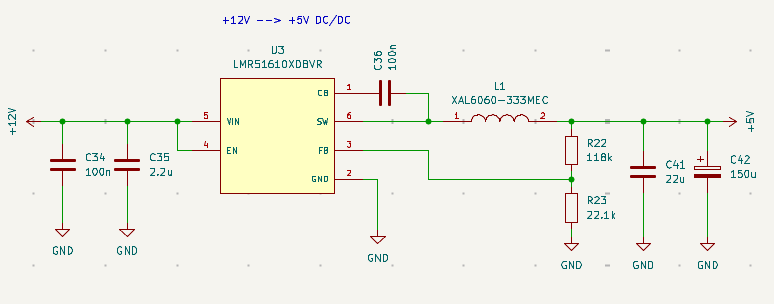
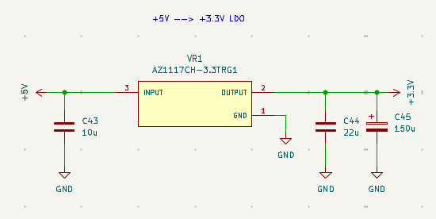

# Заняття 11: Джерела живлення. Частина 2

**Опис завдання**: завершити організацію багатолистової схеми в KiCad, виконати перевірку електричних правил та згенерувати BOM для проєкту.

1. Додайте ієрархічні мітки на лінії всередині листів зі схемами.

2. Синхронізуйте аркуші, закріплені на кореневому листі, та з’єднайте відповідні ієрархічні мітки між аркушами.

3. Виконайте перевірку електричних правил (ERC).

4. Згенеруйте BOM для проєкту.

## Рішення завдання

| № | Пункт | Стан |
|---|-------|------|
| 1 | Ієрархічні мітки всередині листів | ✅ виконано |
| 2 | Синхронізація аркушів і з'єднання на кореневому листі | ✅ виконано |
| 3 | ERC | ✅ 0 помилок, 0 попереджень |
| 4 | BOM | ✅ виконано |

### 1. Ієрархічні мітки

Сигнали між листами згруповані в ієрархічні шини (bus alias, задані в проєкті).
На кожному листі шина виходить на ієрархічну мітку з тим самим ім'ям:

| Шина | Сигнали | Листи |
|------|---------|-------|
| `DRV{SPI}` | nSCS, SCLK, SDI, SDO | MCU ↔ Gate Driver |
| `DRV{PWM6}` | INHA, INLA, INHB, INLB, INHC, INLC | MCU --> Gate Driver |
| `DRV{CTRL}` | EN_GATE, WAKE | MCU --> Gate Driver |
| `DRV{STATUS}` | nFAULT, PWRGD | Gate Driver --> MCU |
| `GATE{GATE6}` | GHA, GLA, GHB, GLB, GHC, GLC | Gate Driver --> Inverter |
| `PH{SENSE6}` | SHA, SHB, SHC, SLA, SLB, SLC | Inverter ↔ Gate Driver |
| `CS{SHUNT6}` | SN_HA, SN_LA, SN_HB, SN_LB, SN_HC, SN_LC | Inverter --> Gate Driver |
| `ANALOG{AIN4}` | SO1, SO2, SO3, TEMP | Gate Driver, Inverter --> MCU |

Лист **Power** не має ієрархічних міток: усі його виходи (+12M, +12V, +5V, +3.3V, GND) -
символи живлення KiCad. Вони глобальні, тож з'єднуються з однойменними символами
на інших листах без проводів на кореневому листі.

### 2. Синхронізація листів

На кореневому листі для кожного аркуша виконано синхронізацію ієрархічних міток.
Отримані виводи аркушів з'єднані шинами:


### 3. Перевірка електричних правил (ERC)

ERC по всьому проєкту (`make hardware` або **Inspect --> Electrical Rules Checker**):

```
***** Sheet /
***** Sheet /MCU/
***** Sheet /Gate Driver/
***** Sheet /Inverter/
***** Sheet /Power/

 ** ERC messages: 0  Errors 0  Warnings 0

 ** Ignored checks:
    - Global label only appears once in the schematic
    - Four connection points are joined together
    - SPICE model issue
    - Assigned footprint doesn't match footprint filters
```

### 4. Генерування BOM для проекту

Робоча напруга конденсатора - обов'язковий параметр для замовлення, тому перед
генерацією BOM у кожного конденсатора потрібно заповнити поле **MaxVoltage**. До цього завдання
воно було лише в 10 конденсаторів листа Power.

**Правило вибору:** номінальна напруга >= 2× робочої (керамика X7R/X5R втрачає ємність
під постійною напругою - DC bias), зі стандартного ряду 10 / 16 / 25 / 50 В. Де даташит
задає напругу явно - за даташитом. Для +12M і +12V - 25 В (13.2 В = 12 В + 10 %;
кидок до 29.2 В обмежує TVS SMBJ18A на короткий час).

**4.1. Заміна кондансаторів на кожній фазі двигуна** - попередньо всі розрахунки базувалися на тому що
струм що проходить через двигун був 14 А, і потрібно перерахувати ємність конденсаторів
для нового струму в 5 А.

Для запасу в 2 рази відповідний струм буде Imax = 5 А * 2 = 10 А.

На кожні 10 А струму потрібно встановлювати 100 - 200 мкФ. Візьмемо середнє значення (200 + 100) / 2 = 150 мкФ на 10 А.

На наш максимальний струм 10 А ємність конденсатора буде дорівнювати 150 мкФ.
Змінюємо значення конденсаторів C25, C29, C32 на 150 мкФ.

**4.2. Уніфікація значення Value** - для деяких номіналів виявилося що однакомі номінали позначаються різними значеннями.
Наприклад є значення 0.1u та 100n для різних конденсаторів. Якщо це не зробити, то однакові компоненти потраплять у різні
рядки BOM.

- Замінюю значення `0.1u` на `100n` для конденсаторів C34, C36, C40;
- Те ж саме роблю зі значенням `1000p` - міняю на `1n` для C27, C30, C33;
- Замінюю значення Value `100R` на `100` для резисторів R12, R13, R16, R17, R19, R20.

**4.3. Додатковий конденсатор на вихід DC-DC перетворювача** - з попереднього домашнього завдання
у викладача було зауваження що встановленого керамічний конденсатора на 22 мкФ мало і потрібно встановити
додатковий або танталовий або електролітичний конденсатор номіналом 100 - 220 мкФ.
Так як струм на виході дорівнює 165 мА, то достатньо встановити середній конденсатор на 150 мкФ 25 В.
Номінал та напруга вибрані на основі вже існуючих конденсаторів C25, C29 та C32 - 150 мкФ 25 В,
що встановлені на живлення кожної з фаз двигуна.

- Додаю конденсатор C42 на вихід DC-DC перетворювача (+5V) номіналом `150u` на `25V`.



**4.4. Додатковий конденсатор на вихід LDO** - з попереднього домашнього завдання
у викладача було зауваження що встановленого керамічний конденсатора на 22 мкФ на виході LDO мало і потрібно встановити
додатковий або танталовий або електролітичний конденсатор номіналом 100 - 220 мкФ.
Так як струм на виході дорівнює 130 мА, то достатньо встановити середній конденсатор на 150 мкФ 25 В.

- Додаю конденсатор C45 (після 4.10 - **C44**) на вихід LDO (+3.3V) номіналом `150u` на `25V`.



**4.5. Заповнення поля MaxVoltage** - мінімально допустима напруга для кожного конденсатора.
Фактичні номінали після уніфікації - у пункті 4.10:

| Конденсатори | Коло | Робоча напруга | MaxVoltage | Умова |
|--------------|------|----------------|---------|----------|
| C1–C7 | +3.3V, VDDA | 3.3 В | 10V | >= 2× |
| C19 | VDDA | 3.3 В | 16V | >= 2×, як C18 |
| C9, C10 | VCAP_1/2 MCU | 1.2 В | 10V | >= 2× |
| C12, C13 | NRST, VBAT | 3.3 В | 10V | >= 2× |
| C26 | ANALOG.TEMP | ≤ 3.3 В | 10V | >= 2× |
| C11, C14 | OSC_IN/OUT (C0G 30 пФ) | 3.3 В | 50V | стандарт для C0G 0603 |
| C8 | +5V | 5 В | 16V | >= 2×, як C43 |
| C15 | DRV.WAKE (+5V) | 5 В | 50V | C0G, як C27, C30, C33 |
| C20, C21 | AVDD, DVDD DRV8305 | 5 В / 3.3 В | 16V | даташит DRV8305: >= 6.3 В; як C18 |
| C18 | VCP_LSD | ≈ 10 В | 16V | даташит DRV8305: 16 В |
| C23 | VCPH − PVDD | ≈ 10 В | 16V | даташит DRV8305: 16 В |
| C16 | CP1H − CP1L | PVDD | 25V | даташит DRV8305: rated for PVDD |
| C17 | CP2H − CP2L | 2 × PVDD ≈ 26 В | 50V | даташит DRV8305: rated for PVDD × 2 |
| C22 | +12M (PVDD) | 12 В | 25V | даташит DRV8305: rated for PVDD |
| C24, C28, C31 | +12M | 12 В | 25V | >= 2× |
| C25, C29, C32 | +12M (електроліт 150 мкФ) | 12 В | 25V | >= 2× |
| C42, C45 | +5V, +3.3V (електроліт 150 мкФ) | 5 В / 3.3 В | 25V | як C25, C29, C32 |
| C27, C30, C33 | SN_Hx − SN_Lx (між входами CSA) | десятки мВ | 50V | стандарт для C0G 0603 |

**4.6. Поля для замовлення** - додано поле `MaxVoltage` і додані поля
`Manufacturer`, `MPN` (артикул виробника) та `Supplier` (постачальник). Заповнені для всіх
компонентів; тримач батарейки - J4 Harwin `S8421-45R`; сама батарейка CR2032
до BOM не входить (окремого символу в схемі немає, купується окремо). NT1 (net tie GND - EP драйвера) -
мідь на платі, а не деталь, тому виключений з BOM (`in_bom no`). Пасивні
компоненти - серії YAGEO CC (кераміка) і RC0603 (резистори), постачальник - Mouser.
При виборі C15 (1 нФ) взято C0G на 50 В, як C27, C30, C33, а C19–C21 (1 мкФ) - як C18
(після 4.10 - 25 В): однакові компоненти потрапляють в один рядок BOM.

**4.7. Переанотація** - після додавання C42, C45 і заміни тримача батарейки позиційні позначення оновлено (Annotate):

| Компонент | Було (ДЗ 10) | Стало |
|-----------|--------------|-------|
| TVS SMBJ18A | VD2 | VD1 |
| Шотткі SS14 (+12V) | VD3 | VD2 |
| Шотткі SS10P4 (+12M) | VD5 | VD3 |
| 10 мкФ на вході LDO (+5V) | C42 | C43 |
| 22 мкФ на виході LDO (+3.3V) | C43 | видалено (див. 4.10) |
| 150 мкФ на виході LDO (+3.3V) | - | C44 |
| Драйвер DRV8305NPHP | U3 | U2 |
| Buck LMR51610 | U4 | U3 |
| Роз'єм двигуна 1726486303 | J4 | J5 |
| Тримач батарейки | U2 (`CR2032`) | J4 (Harwin `S8421-45R`) |

**4.8. Колонки BOM у CI** - `tools/kicad-outputs.sh` генерує BOM з колонками
`Refs, Qty, Value, MaxVoltage, Footprint, Manufacturer, MPN, Supplier` і групує рядки
за `Value, MaxVoltage, Footprint, MPN` - однакові номінали з різною напругою або різним
артикулом потрапляють у різні рядки. Компоненти з атрибутом DNP (Do Not Populate)
у BOM не потрапляють (`--exclude-dnp`).

**4.9. Генеруємо BOM** - **Tools --> Generate Bill of Materials** або `make hardware`
(--> `build/hardware/motor-drive-controller-bom.csv`).

Перевіряємо:

- [x] немає порожніх MaxVoltage у конденсаторів;
- [x] повторюємо ERC - помилки та зауваження відсутні:

```
***** Sheet /
***** Sheet /MCU/
***** Sheet /Gate Driver/
***** Sheet /Inverter/
***** Sheet /Power/

 ** ERC messages: 0  Errors 0  Warnings 0

 ** Ignored checks:
    - Global label only appears once in the schematic
    - Four connection points are joined together
    - SPICE model issue
    - Assigned footprint doesn't match footprint filters
```

**4.10. Оптимізація BOM** - зауваження викладача:

> Потрібно оптимізувати BOM. Багато позицій дублюються. Для простоти закупівлі і оптимізації
> виробничої лінії всі номінали потрібно звести до одного. Наприклад, якщо є конденсатори 100 нФ
> з напругою 50 В і 16 В, усі повинні бути на 50 В. Ціна роботи додаткового фідера для SMT-лінії
> вища, ніж кілька центів з BOM. Допускається мати дубль номіналу, якщо є характеристики певного
> партномера, критичні для роботи таких вузлів, як, наприклад, RF.

Кожен рядок BOM - окремий партномер, тобто окрема котушка і фідер на SMT-лінії. Тому для
кожного номіналу залишаю один партномер з найбільшою потрібною напругою: вищий номінал
напруги підходить для всіх кіл з меншою робочою напругою (правило >= 2× з 4.5 лише
посилюється, а менший DC bias кераміки X7R - тільки плюс).

**Уніфікація номіналів:**

| Номінал | Було | Стало | Конденсатори |
|---------|------|-------|--------------|
| 100n | 3 партномери: 10 В (KYOCERA AVX), 16 В (KEMET), 25 В (YAGEO) | 1: `CC0603KRX7R8BB104`, 25 В, 0603 | C2–C5, C7, C8, C12, C13, C24, C26, C28, C31, C34, C36, C40 (15 шт.) |
| 1u | 16 В і 25 В | 1: `CC0603KRX7R8BB105`, 25 В, 0603 | C18–C21, C39 |
| 2.2u | 10 В, 16 В (0805) і 50 В (1206) | 1: `CC1206KKX7R9BB225`, 50 В, 1206 | C9, C10, C23, C35 |
| 4.7u | 10 В (0805) і 25 В (1206) | 1: `CC1206KKX7R8BB475`, 25 В, 1206 | C1, C22 |
| 10u | 10 В (0805) і 16 В (1206) | 1: `CC1206KKX7R7BB106`, 16 В, 1206 | C6, C43 |
| 47n | 25 В і 50 В | 1: `CC0603KRX7R9BB473`, 50 В, 0603 | C16, C17 |
| 22u | 10 В (0805, вихід LDO) і 25 В (1210) | 1: `CC1210KKX7R8BB226`, 25 В, 1210 - конденсатор 10 В видалено (див. нижче) | C37, C38, C41 |

Номінали 2.2u, 4.7u і 10u на нижчу напругу були в корпусі 0805; ці конденсатори
переведено в 1206 разом з партномером. Різні номінали (30p, 1n C0G, 150u) не дублюються
й лишаються як є.

**Вихід LDO без кераміки** - друге зауваження викладача:

> Потрібно повністю прибрати C43. Наявність керамічного конденсатора поруч з LDO призведе
> до втрати його стабільності, навіть якщо стоїть електроліт.

C43 у позначеннях ДЗ 10 - це керамічний 22 мкФ на виході LDO (у 4.7 - C44). Його видалено,
на виході VR1 залишився тільки електроліт 150 мкФ / 25 В (C45 --> **C44** після переанотації).
Вимогу даташиту AZ1117C до вихідного конденсатора (>= 10 мкФ, ESR < 20 Ом) електроліт
виконує сам. Заодно з BOM зник рядок 22u / 10 В (`CC0805MKX5R6BB226`).

**Результат:**

| | До оптимізації | Після |
|---|:---:|:---:|
| Рядків BOM (партномерів, фідерів) | 46 | 37 |
| з них конденсаторів | 19 | 10 |
| Компонентів | 93 | 92 |

ERC після змін - 0 помилок, 0 попереджень.
