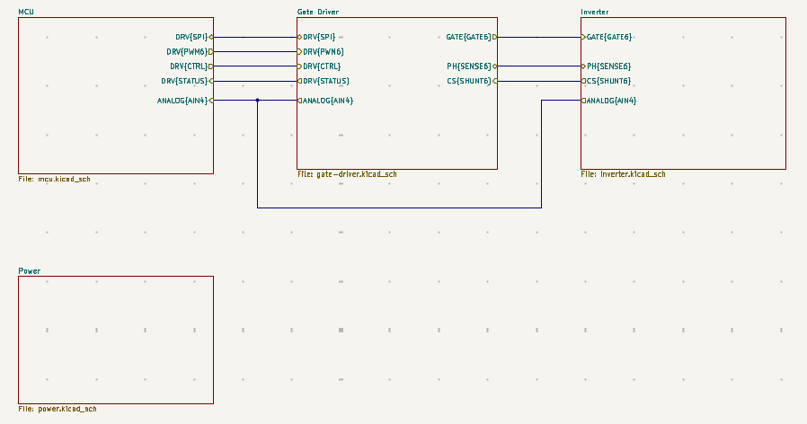

# Заняття 11: Джерела живлення. Частина 2

**Опис завдання**: завершити організацію багатолистової схеми в KiCad, виконати перевірку електричних правил та згенерувати BOM для проєкту.

1. Додайте ієрархічні мітки на лінії всередині листів зі схемами.

2. Синхронізуйте аркуші, закріплені на кореневому листі, та з’єднайте відповідні ієрархічні мітки між аркушами.

3. Виконайте перевірку електричних правил (ERC).

4. Згенеруйте BOM для проєкту.

## Рішення завдання

| № | Пункт | Стан |
|---|-------|------|
| 1 | Ієрархічні мітки всередині листів | ✅ виконано |
| 2 | Синхронізація аркушів і з'єднання на кореневому листі | ✅ виконано |
| 3 | ERC | ✅ 0 помилок, 0 попереджень |
| 4 | BOM | ⏳ потрібно виконати |

### 1. Ієрархічні мітки

Сигнали між листами згруповані в ієрархічні шини (bus alias, задані в проєкті).
На кожному листі шина виходить на ієрархічну мітку з тим самим ім'ям:

| Шина | Сигнали | Листи |
|------|---------|-------|
| `DRV{SPI}` | nSCS, SCLK, SDI, SDO | MCU ↔ Gate Driver |
| `DRV{PWM6}` | INHA, INLA, INHB, INLB, INHC, INLC | MCU --> Gate Driver |
| `DRV{CTRL}` | EN_GATE, WAKE | MCU --> Gate Driver |
| `DRV{STATUS}` | nFAULT, PWRGD | Gate Driver --> MCU |
| `GATE{GATE6}` | GHA, GLA, GHB, GLB, GHC, GLC | Gate Driver --> Inverter |
| `PH{SENSE6}` | SHA, SHB, SHC, SLA, SLB, SLC | Inverter ↔ Gate Driver |
| `CS{SHUNT6}` | SN_HA, SN_LA, SN_HB, SN_LB, SN_HC, SN_LC | Inverter --> Gate Driver |
| `ANALOG{AIN4}` | SO1, SO2, SO3, TEMP | Gate Driver, Inverter --> MCU |

Лист **Power** не має ієрархічних міток: усі його виходи (+12M, +12V, +5V, +3.3V, GND) -
символи живлення KiCad. Вони глобальні, тож з'єднуються з однойменними символами
на інших листах без проводів на кореневому листі.

### 2. Синхронізація листів

На кореневому листі для кожного аркуша виконано синхронізацію ієрархічних міток.
Отримані виводи аркушів з'єднані шинами:



### 3. Перевірка електричних правил (ERC)

ERC по всьому проєкту (`make hardware` або **Inspect --> Electrical Rules Checker**):

```
***** Sheet /
***** Sheet /MCU/
***** Sheet /Gate Driver/
***** Sheet /Inverter/
***** Sheet /Power/

 ** ERC messages: 0  Errors 0  Warnings 0

 ** Ignored checks:
    - Global label only appears once in the schematic
    - Four connection points are joined together
    - SPICE model issue
    - Assigned footprint doesn't match footprint filters
```

### 4. Генерування BOM для проекту

Робоча напруга конденсатора - обов'язковий параметр для замовлення, тому перед
генерацією BOM у кожного конденсатора потрібно заповнити поле **MaxVoltage**. Зараз воно є лише
в 10 конденсаторів листа Power (C34–C43).

**Правило вибору:** номінальна напруга >= 2× робочої (керамика X7R/X5R втрачає ємність
під постійною напругою - DC bias), зі стандартного ряду 10 / 16 / 25 / 50 В. Де даташит
задає напругу явно - за даташитом. Для +12M і +12V - 25 В (13.2 В = 12 В + 10 %;
кидок до 29.2 В обмежує TVS SMBJ18A на короткий час).

**4.1. Заміна кондансаторів на кожній фазі двигуна** - попередньо всі розрахунки базувалися на тому що
струм що проходить через двигун був 14 А, і потрібно перерахувати ємність конденсаторів
для нового струму в 5 А.

Для запасу в 2 рази відповідний струм буде Imax = 5 А * 2 = 10 А.

На кожні 10 А струму потрібно встановлювати 100 - 200 мкФ. Візьмемо середнє значення (200 + 100) / 2 = 150 мкФ на 10 А.

На наш максимальний струм 10 А ємність конденсатора буде дорівнювати 150 мкФ.
Змінюємо значення конденсаторів C25, C29, C32 на 150 мкФ.

**4.2. Уніфікація значення Value** - для деяких номіналів виявилося що однакомі номінали позначаються різними значеннями.
Наприклад є значення 0.1u та 100n для різних конденсаторів. Якщо це не зробити, то однакові компоненти потраплять у різні
рядки BOM.

- Замінюю значення `0.1u` на `100n` для конденсаторів C34, C36, C40;
- Те ж саме роблю зі значенням `1000p` - міняю на `1n` для C27, C30, C33;
- Замінюю значення Value `100R` на `100` для резисторів R12, R13, R16, R17, R19, R20.

**4.3. Додатковий конденсатор на вихід DC-DC перетворювача** - з попереднього домашнього завдання
у викладача було зауваження що встановленого керамічний конденсатора на 22 мкФ мало і потрібно встановити
додатковий або танталовий або електролітичний конденсатор номіналом 100 - 220 мкФ.
Так як струм на виході дорівнює 165 мА, то достатньо встановити середній конденсатор на 150 мкФ 25 В.
Номінал та напруга вибрані на основі вже існуючих конденсаторів C25, C29 та C32 - 150 мкФ 25 В,
що встановлені на живлення кожної з фаз двигуна.

- Додаю конденсатор на вихід DC-DC перетворювача номіналом `150u` на `25V`.

**4.4. Додатковий конденсатор на вихід LDO** - з попереднього домашнього завдання
у викладача було зауваження що встановленого керамічний конденсатора на 22 мкФ на виході LDO мало і потрібно встановити
додатковий або танталовий або електролітичний конденсатор номіналом 100 - 220 мкФ.
Так як струм на виході дорівнює 130 мА, то достатньо встановити середній конденсатор на 150 мкФ 25 В.

- Додаю конденсатор на вихід LDO перетворювача номіналом `150u` на `25V`.

**4.5. Заповнення поля MaxVoltage**:

| Конденсатори | Коло | Робоча напруга | MaxVoltage | Умова |
|--------------|------|----------------|---------|----------|
| C1–C7, C19 | +3.3V, VDDA | 3.3 В | 10V | >= 2× |
| C9, C10 | VCAP_1/2 MCU | 1.2 В | 10V | >= 2× |
| C12, C13 | NRST, VBAT | 3.3 В | 10V | >= 2× |
| C26 | ANALOG.TEMP | ≤ 3.3 В | 10V | >= 2× |
| C11, C14 | OSC_IN/OUT (C0G 30 пФ) | 3.3 В | 50V | стандарт для C0G 0603 |
| C8 | +5V | 5 В | 16V | >= 2×, як C42 |
| C15 | DRV.WAKE (+5V) | 5 В | 16V | >= 2× |
| C20, C21 | AVDD, DVDD DRV8305 | 5 В / 3.3 В | 10V | даташит DRV8305: >= 6.3 В |
| C18 | VCP_LSD | ≈ 10 В | 16V | даташит DRV8305: 16 В |
| C23 | VCPH − PVDD | ≈ 10 В | 16V | даташит DRV8305: 16 В |
| C16 | CP1H − CP1L | PVDD | 25V | даташит DRV8305: rated for PVDD |
| C17 | CP2H − CP2L | 2 × PVDD ≈ 26 В | 50V | даташит DRV8305: rated for PVDD × 2 |
| C22 | +12M (PVDD) | 12 В | 25V | даташит DRV8305: rated for PVDD |
| C24, C28, C31 | +12M | 12 В | 25V | >= 2× |
| C25, C29, C32 | +12M (електроліт 330 мкФ) | 12 В | 25V | >= 2× |
| C27, C30, C33 | SN_Hx − SN_Lx (між входами CSA) | десятки мВ | 50V | стандарт для C0G 0603 |

**4.6. Додаємо колонку MaxVoltage у BOM, який генерує CI** - `tools/kicad-outputs.sh`:
поле `MaxVoltage` у `--fields` і `--group-by`. Налаштування BOM у самому KiCad
(`.kicad_pro`) уже згруповані по MaxVoltage.

**4.7. Генеруємо BOM** - **Tools --> Generate Bill of Materials** або `make hardware`
(--> `build/hardware/motor-drive-controller-bom.csv`).

Перевіряємо:

- [x] немає порожніх MaxVoltage у конденсаторів;
- [x] повторюємо ERC - помилки та зауваження відсутні:

```
***** Sheet /
***** Sheet /MCU/
***** Sheet /Gate Driver/
***** Sheet /Inverter/
***** Sheet /Power/

 ** ERC messages: 0  Errors 0  Warnings 0

 ** Ignored checks:
    - Global label only appears once in the schematic
    - Four connection points are joined together
    - SPICE model issue
    - Assigned footprint doesn't match footprint filters
```
