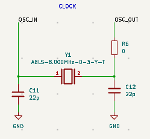

# Заняття 12: Основи PCB Layout та технології виробництва

**Опис завдання**

1. На окремому ієрархічному листі з механікою або на верхньому листі ієрархії розмістіть монтажні отвори (MountingHole) зі стандартної бібліотеки KiCad із посадковим місцем під гвинт M3.
2. Додатково розмістіть тестові точки (стандартна бібліотека, TestPoint).
3. Створіть проєкт друкованої плати на основі розробленої принципової схеми.
4. Виконайте розміщення компонентів на платі без трасування відповідно до стратегії розміщення, розглянутої на занятті (додатково ілюстрація в папці з Ресурсами).
5. Трасування на цьому етапі не виконувати.

## План завдання

| № | Пункт | Стан |
|---|-------|------|
| 1 | Монтажні отвори M3 на схемі | ✅ |
| 2 | Тестові точки на схемі | ✅ |
| 3 | Проєкт плати: налаштування, правила, імпорт зі схеми | ✅ |
| 4 | Розміщення компонентів за стратегією | ⬜ |
| 5 | Без трасування: лише ratsnest, перевірка DRC | ⬜ |
| — | Звіт, зображення, `checklist.md`, `pull-request.md` | ⬜ |

### 1. Монтажні отвори

- Додаю на кореневий лист 4 монтажні отвори на гвинт M3 за допомогою компонента `Mechanical:MountingHole`,
з footprint-м `MountingHole:MountingHole_3.2mm_M3` - ізольовані отвори;
- Перевіряю властивості `Exclude From Bill of Materials` - повинні бути встановлені в ✅;
- Перевіряю ERC - без помилок.

### 2. Тестові точки

Для тестових аналогових та цифрових точок вибираємо схематичне позначення `Connector:TestPoint`,
footprint `TestPoint:TestPoint_THTPad_D2.0mm_Drill1.0mm` — контактна площадка з отвором:
щуп заходить в отвір і не зісковзує, за потреби можна впаяти дротяну петлю під затискач.

Для силових тестових точок та GND вибираємо footprint `TestPoint:TestPoint_THTPad_D2.5mm_Drill1.2mm`.

Тестові точки виключено з BOM (`Exclude from Bill of Materials`): це мідь плати, а не компонент на закупівлю.

**Список точок:**

На схемі місце символу не впливає на плату: точка на тій самій мережі дає
той самий нетлист. Тому символи стоять на листі, де їх шукатимуть, а місце
на платі задано окремо (колонка «Де на платі», Етап 4).

| Ref | Мережа | Лист | Footprint (пад/отвір, мм) | Де на платі | Навіщо |
|-----|--------|------|-----------|-------------|--------|
| TP1 | GND | MCU | THT D2.5/1.2 | біля PC0–PC3, поруч із TP3–TP6 | сигнальна земля для щупа АЦП-сигналів |
| TP2 | NRST | MCU | THT D2.0/1.0 | біля MCU / SW1 | налагодження, ручне скидання |
| TP3 | ANALOG.TEMP | MCU | THT D2.0/1.0 | біля входу АЦП PC0 | вхід АЦП з датчика температури |
| TP4–TP6 | ANALOG.SO1–SO3 | MCU | THT D2.0/1.0 | біля входів АЦП PC1–PC3, пад на доріжці без відгалуження | що реально бачить АЦП (після доріжки від DRV8305) |
| TP7, TP8 | DRV.nFAULT, DRV.PWRGD | MCU | THT D2.0/1.0 | біля MCU | стан драйвера |
| TP9 | VREG драйвера (після R9 від VDDA) | Gate Driver | THT D2.5/1.2 | біля піна VREG U2 | опорна напруга підсилювачів струму (зміщення SOx = VREF/2) |
| TP10 | GND | Gate Driver | THT D2.5/1.2 | біля витоків нижніх ключів | земля для щупа фаз і затворів (коротка петля) |
| TP11–TP13 | PH.SHA / PH.SHB / PH.SHC | Inverter | THT D2.5/1.2 | на полігоні вузла комутації кожного напівмоста, збоку від контуру комутації | осцилограми фаз, dead-time |
| TP14–TP19 | GATE.GHA/GLA … GHC/GLC | Inverter | THT D2.5/1.2 | біля затворів MOSFET | налагодження dead-time; GHx міряти відносно SHx (різниця каналів) |
| TP20 | GND | Power | THT D2.5/1.2 | біля +12M / +12V | земля для постійної напруги |
| TP21 | +12M | Power | THT D2.5/1.2 | після VD3, біля C25/C29/C32 (150 мкФ) | силова шина після захисту |
| TP22 | +12V | Power | THT D2.5/1.2 | після VD2 | шина живлення логіки після захисту |
| TP23 | +5V | Power | THT D2.5/1.2 | впритул до вихідного конденсатора buck, у парі з TP24 | вихід LMR51610, перше увімкнення, пульсації |
| TP24 | GND | Power | THT D2.5/1.2 | ~5 мм від TP23, на GND вихідного конденсатора buck | земля для виміру пульсацій (ground spring) |
| TP25 | +3.3V | Power | THT D2.5/1.2 | біля виходу LDO VR1 | вихід AZ1117C, перше увімкнення |

GND — одна мережа (`power:GND`), окремих точок «на землю buck» і «на землю
LDO» не потрібно: TP24 і TP20 обслуговують усю зону живлення. Землю для
щупа ставлять поруч із точкою, яку міряють на високій частоті (фази,
пульсації buck), щоб петля щупа була мінімальною.
 
### 3. Проєкт плати

- **Лист для механіки.** На кореневому листі додаю 4 монтажні ізольовані отвори `MountingHole_3.2mm_M3`;
- **Кількість шарів.** вибираю 4 шари плати: зовнішні 1 oz, внутрішні 0.5 oz;
- **Виробник** - вибираю виробника JLCPCB, значення взято з [PCB Capabilities](https://jlcpcb.com/capabilities/pcb-capabilities);
- **Габарит і кріплення.** вибираю 60 × 90 мм, отвори по кутах, відстань від краю 5 мм.
- **Контур `Edge.Cuts`** - заокруглені кути радіусом 4 мм.

**Правила (Board Setup → Design Rules → Constraints):**

| Параметр | Ліміт JLCPCB, мм | У проєкті, мм |
|----------|------------------|---------------|
| Мін. зазор | 0.09, до пада 0.1 | 0.1 |
| Мін. ширина доріжки / з'єднання | 0.09 | 0.15 |
| Мін. отвір | 0.15 | 0.3 |
| Мін. діаметр via | 0.25 | 0.5 |
| Мін. поясок via | ≈ 0.05 | 0.1 |
| Зазор отвір–мідь | via 0.2, PTH 0.28 | 0.3 |
| Отвір–отвір | via 0.2, пад 0.45 | 0.5 |
| Мідь–край плати | 0.2 | 0.5 |
| Шовкографія: висота / товщина / до пада | 1.0 / 0.15 / 0.15 | 1.0 / 0.15 / 0.15 |
| Мін. перемичка маски | 0.1 | 0.1 |

Робочий via 0.3/0.6 мм: отвори 0.2–0.25 мм при діаметрі via менше 0.45 мм JLCPCB робить за додаткову оплату.

**Стек** (за `JLC04161H-3313`, загальна товщина ≈ 1.58 мм, покриття HASL зі свинцем (SnPb)):

| Шар | Товщина, мм | Epsilon r |
|-----|-------------|----|
| F.Cu / B.Cu (1 oz) | 0.035 | — |
| Препрег 3313 (2 шт.) | 0.0994 | 4.1 |
| In1.Cu / In2.Cu (0.5 oz) | 0.0152 | — |
| Ядро | 1.265 | 4.6 |

**Класи мереж:**

| Клас | Мережі | Доріжка, мм | Зазор, мм | Via, мм |
|------|--------|-------------|-----------|---------|
| `Default` | решта, зокрема лінії шунтів `CS.SN_*` | 0.2 | 0.15 | 0.6/0.3 |
| `Supply` | `+12V`, `+5V`, `+3.3V` | 0.5 | 0.15 | 0.6/0.3 |
| `Power` | `+12_IN`, `Net-(VD3-Anode_1)`, `+12M`, `/Gate Driver/PH.S*` | 3.0 | 0.2 | 0.8/0.4 |

Зазор `Power` не більший за 0.2 мм, бо це зазор між падами U2 (виводи SHx).

Ширина міді за IPC-2221 (зовнішній шар 1 oz, нагрів 20 °C), двигун 5 А:
фази й шунти при 5 А — 1.8 мм; вхід і `+12M` при 7 А (з запасом над вхідними 5.1 А) — 2.9 мм.
Ширина 3.0 мм класу `Power` покриває обидва випадки на одному зовнішньому шарі.
F1 на 10 А розриває коло за ≤ 5 с при 35 А, такий короткочасний струм доріжка 3 мм витримує.

**Footprint U2 (DRV8305):** отвори термопада 0.2/0.3 → 0.3/0.6 мм, `solder_mask_margin` 0.102 → 0
(перемичка маски між падами 0.2 мм).

#### Кварц ABLS-8.000MHz-D-3-Y-T і резистор $R_{ext}$

Тактовий генератор розраховано за [AN2867](https://www.st.com/resource/en/application_note/an2867-oscillator-design-guide-for-stm32-microcontrollers-stmicroelectronics.pdf)
для кварца Abracon [ABLS-8.000MHz-D-3-Y-T](https://abracon.com/Resonators/abls.pdf) (HC-49/US SMD, 11.4 × 4.7 × 4.2 мм):
f = 8 МГц, ESR ≤ 80 Ом, C0 ≤ 7 пФ, CL = 18 пФ, допустима потужність 1000 мкВт, −40…+85 °C.

Попередній кварц ABM3BAIG-8.000MHZ-1Z-T (ESR 150 Ом, межа 100 мкВт) не проходив перевірку потужності:
при повній амплітуді 3.3 В на кварці було б ≈ 512 мкВт, у 5 разів більше за допустиме.

**1. Конденсатори C11, C12**

Паразитну ємність плати й виводів беру Cs = 7 пФ (datasheet STM32F405 радить оцінку до 10 пФ):

$$C_{ext} = 2 \cdot (C_L - C_s) = 2 \cdot (18 - 7) = 22\text{ пФ}$$

22 пФ входить у рекомендований діапазон STM32F405 (5–25 пФ).

**2. Потужність на кварці (AN2867, п. 3.5.2)**

$$DL = \frac{ESR \cdot (\pi \cdot f \cdot C_{tot} \cdot V_{pp})^2}{2}, \quad C_{tot} = C11 + \frac{C_s}{2} = 25.5\text{ пФ}$$

У найгіршому випадку коливання на OSC_IN займають усю напругу живлення, Vpp = 3.3 В:

| Cs, пФ | DL, мкВт (ESR 80 Ом) | DL, мкВт (ESR 154 Ом*) | Межа 1000 мкВт |
|-----|-----|-----|-----|
| 3 | 152 | 293 | ✅ |
| 7 | 179 | 345 | ✅ |
| 10 | 201 | 387 | ✅ |

\* Якщо R1 у datasheet — динамічний опір, то ESR = R1 · (1 + C0/CL)² ≈ 154 Ом.

Межа не досягається навіть при максимальній амплітуді, тому вимірювати потужність на платі не обов'язково.

**3. Резистор Rext (R6)**

AN2867: Rext обов'язковий, лише якщо потужність перевищує допустиму, інакше Rext = 0 Ом.
Перевищення немає, тому **R6 = 0 Ом**. Місце під резистор 0603 лишається на платі на випадок налаштування.

Первинна оцінка за AN2867 (XC12 ≈ 904 Ом при 22 пФ) тут не підходить: з таким резистором генератор не пройде перевірку запуску нижче.

**4. Перевірка запасу запуску**

$$g_{mcrit} = 4 \cdot (ESR + R_{ext}) \cdot (2\pi f)^2 \cdot (C_0 + C_L)^2$$

Вимоги STM32F405: gmcrit ≤ 1 мА/В (Gmcritmax), запас Gm / gmcrit ≥ 5 при Gm = 5 мА/В.

| Умови (R6 = 0) | gmcrit, мА/В | Запас | Результат |
|-----|------|------|---|
| ESR 80 Ом, Cs = 7 пФ | 0.51 | 9.9 | ✅ |
| ESR 154 Ом, Cs = 7 пФ | 0.97 | 5.1 | ✅ на межі |
| ESR 154 Ом, Cs = 10 пФ | 1.22 | 4.1 | ⚠️ найгірше поєднання |

Найбільший допустимий Rext ≈ 78 Ом (ESR 80 Ом, Cs = 7 пФ). Найгірший рядок поєднує максимальний ESR,
песимістичне трактування R1 і найбільшу паразитну ємність. Для попереднього кварца в тих самих умовах запас був би 2.9.

**5. Footprint і 3D-модель**

Footprint `XTAL_ABLS-8.000MHz-D-3-Y-T` відповідає рекомендованим падам із datasheet: 5.6 × 2.1 мм, крок 9.5 мм.
3D-модель лягає на пади, висота корпусу 4.2 мм. Кварц має два виводи, металевий корпус не заземлюється.

#### Запобіжник F1: 1206TD-10AS замість MF-R700

PTC MF-R700 — радіальний THT заввишки ≈ 30 мм, а при +40 °C його Ihold падає до 5.81 А
при вхідному струмі 5.1 А. Замінено на плавкий SMD-запобіжник PROSEMI
[1206TD-10AS](https://datasheet.lcsc.com/datasheet/pdf/a35981a0118ee7976fb1786703e292ea.pdf)
(LCSC C2838903, ≈ $0.10): 10 А, 32 VDC @ 50 А, time-delay, 5 мОм, I²t 22 A²s.

- **Номінал 10 А:** 5.1 А / (0.75 · 0.97 derating при +40 °C) ≈ 7 А потрібно; втрати ≈ 0.13 Вт.
- **Time-delay:** витримує заряд C25/C29/C32 (≈ 450 мкФ) при підключенні і пуск двигуна.
- **Бібліотека стандартна:** символ `Device:Fuse`, footprint `Fuse:Fuse_1206_3216Metric` з 3D-моделлю.
- **Обмеження:** струм вимикання 50 А — для лабораторного БЖ; запобіжник одноразовий.

Рішення: [design-notes](../../motor-drive-controller/docs/design-notes.md).

- [x] Board Setup: стек шарів, правила виробника.
- [x] Net classes.
- [x] Update PCB from Schematic (F8): 122 footprint, 0 розбіжностей зі схемою.
- [x] 3D-моделі: підключено всі.
- [x] Кварц Y1 замінено на `ABLS-8.000MHz-D-3-Y-T`, рішення в [design-notes](../../motor-drive-controller/docs/design-notes.md).
- [x] R6 (Rext) = 0 Ом, C11 = C12 = 22 пФ, ERC без порушень.
- [x] F1 замінено на `1206TD-10AS` (`Device:Fuse`, `Fuse:Fuse_1206_3216Metric`), ERC без порушень.
