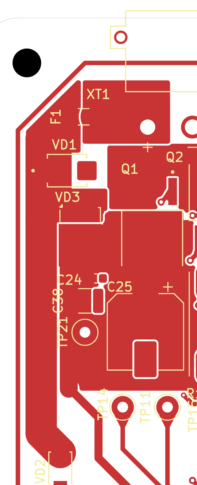
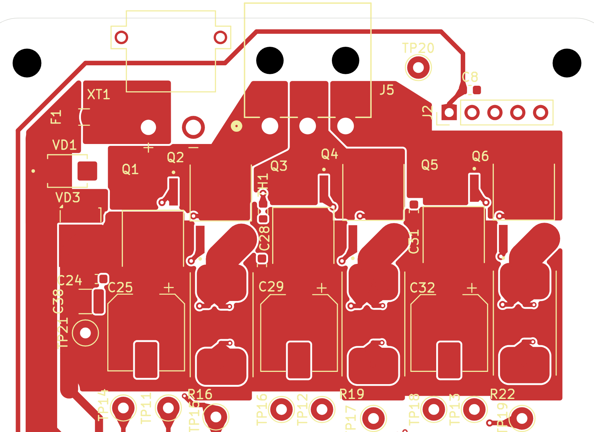
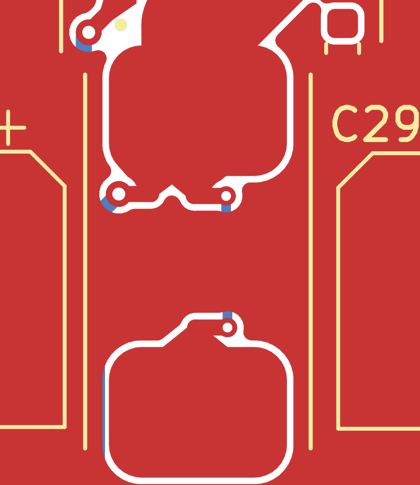
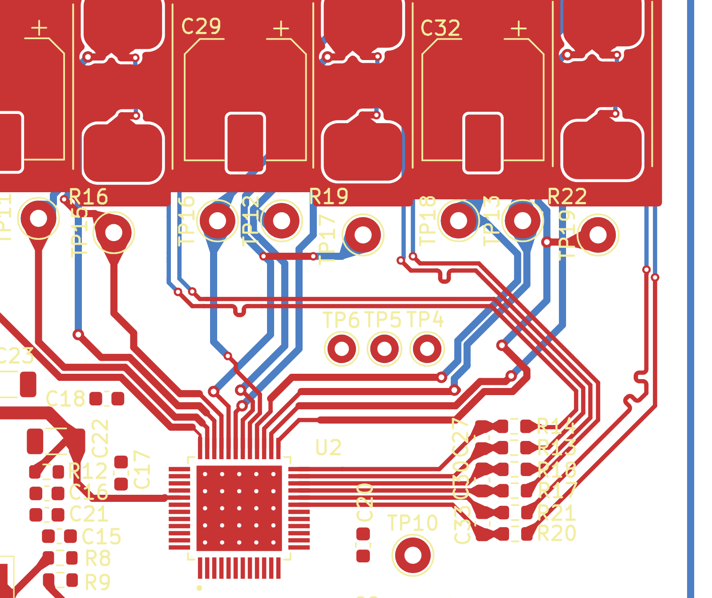

# Заняття 13: Трасування (Routing) та полігони

**Опис завдання**

1. Розрахувати ширину провідників для струму двигуна 4 А з коефіцієнтом запасу ×2.
2. Додати клас мереж HIGH_CURRENT до силових ліній та ліній живлення 12 В.
3. Створити правило трасування (Design Rule) high_current для класу ліній з високим струмом.
4. Виконати трасування аркуша power_switches від входу живлення без трасування GND.
5. Під час трасування:
  * з'єднати роз'єм двигуна та силові ключі полігонами;
  * з'єднати силові ключі між собою полігонами;
  * виконати підключення шунтів за схемою 4-wire Kelvin connection;
  * не прокладати сигнали керування PWM паралельно до аналогових ліній вимірювання струму.

## План завдання

Лист power_switches у проєкті — це лист **Inverter** (`inverter.kicad_sch`):
ключі Q1–Q6 (AOD4184A), шунти R16/R19/R22 (WSR5, 7.5 мОм), роз'єм двигуна J5.

| № | Пункт | Стан |
|---|-------|------|
| 1 | Розрахунок ширини провідників (4 А × 2) | ✅ |
| 2 | Клас мереж `HIGH_CURRENT` | ✅ |
| 3 | Правило `high_current` (`.kicad_dru`) | ✅ |
| 4 | Трасування листа Inverter від входу живлення, без GND | ✅ |
| 5 | Полігони J5 <-> ключі та між ключами, Kelvin-підключення шунтів, PWM ≠ аналог | ✅ |
| — | DRC 0, ERC 0, звіт, зображення | ✅ |
| — | [`checklist.md`](checklist.md), [`pull-request.md`](pull-request.md) | ✅ |

### 1. Розрахунок ширини провідників

**Вихідні дані**

| Параметр | Значення |
|----------|----------|
| Струм двигуна | 4 А |
| Коефіцієнт запасу | ×2 → розрахунковий струм **I = 8 А** |
| Мідь зовнішніх шарів (F.Cu, B.Cu) | 1 oz = 35 мкм = 1.378 mil |
| Мідь внутрішніх шарів (In1.Cu, In2.Cu) | 0.5 oz ≈ 17.5 мкм = 0.689 mil |
| Допустимий перегрів ΔT | 20 °C (додатково 10 і 30 °C для порівняння) |

**Формула IPC-2221** (її ж використовує KiCad Calculator → Track Width):

$$I = k \cdot \Delta T^{0.44} \cdot A^{0.725}, \qquad A = \left(\frac{I}{k \cdot \Delta T^{0.44}}\right)^{1/0.725}, \qquad W = \frac{A}{t}$$

де A — переріз, mil²; t — товщина міді, mil; k = 0.048 для зовнішніх шарів,
k = 0.024 для внутрішніх.

Приклад для зовнішнього шару, ΔT = 20 °C:

- $20^{0.44} = 3.737$; $\;A = \left(\dfrac{8}{0.048 \cdot 3.737}\right)^{1.379} = 44.6^{1.379} \approx 188\ \text{mil}^2$;
- $W = 188 / 1.378 \approx 137\ \text{mil} \approx$ **3.47 мм**.

**Результати - ширина доріжки W:**

| ΔT, °C | Зовнішній 1 oz, 4 А | Зовнішній 1 oz, **8 А** | Внутрішній 0.5 oz, 8 А |
|--------|---------------------|-------------------------|------------------------|
| 10 | 2.03 мм | 5.29 мм | 27.5 мм |
| 20 | 1.33 мм | **3.47 мм** | 18.1 мм |
| 30 | 1.04 мм | 2.71 мм | 14.1 мм |

**Перевірка обраної ширини** (зворотний розрахунок ΔT, зовнішній шар):

| Ширина, мм | ΔT при 4 А | ΔT при 8 А | Опір 10 мм доріжки (40 °C) | Падіння при 4 А на 10 мм |
|------------|------------|------------|----------------------------|--------------------------|
| 3.0 | 5.3 °C | 25.4 °C | — | — |
| **3.5** | **4.1 °C** | **19.7 °C** | 1.5 мОм | 6 мВ |
| 5.3 | 2.1 °C | 10.0 °C | 1.0 мОм | 4 мВ |

**Переходи (via) між шарами.** Для via 0.8/0.4 мм з металізацією отвору 18 мкм
(припущення; уточнити у виробника) переріз стінки $\pi \cdot 0.4 \cdot 0.018 \approx 0.023\ \text{мм}^2 \approx 35\ \text{mil}^2$.
За тією ж формулою (k = 0.048, ΔT = 20 °C) один via витримує ≈ 2.4 А. Отже,
для 8 А в місці переходу між шарами потрібно **не менше 4 via**, з запасом
потрібно поставити 6–8.

**Висновки**

- **Мінімальна ширина силових доріжок — 3.5 мм** на зовнішніх шарах. При
  8 А перегрів становить ≈ 20 °C, при робочих 4 А — ≈ 4 °C. Наявний клас
  `Power` (3.0 мм) цю вимогу не виконує; його потрібно змінити.
- Внутрішні шари 0.5 oz для силового струму не підходять: потрібно 18 мм і
  більше. Силовий струм веду тільки по F.Cu/B.Cu.
- Біля ключів і шунтів для доріжок 3.5–5 мм мало місця, тому там потрібно
  використовувати полігони. Їхня ширина значно більша за розрахункову.
  Також вони допомогають відводити тепло від ключів.
- Деякі пади вужчі за 3.5 мм: вивід витоку DPAK — 0.97 мм × 3.02 mm, F1 (1206) —
  1.25 мм × 1.75 mm, анод VD3 — 1.4 мм × 1.27 mm (але має 2 пади).
  Звуження до ширини пада допускається тільки на короткій ділянці біля пада (до ≈ 1–2 мм);
  у правилі `high_current` для цього можна зробити виняток.
- Пади, які приймають силовий струм: стік DPAK (5.67 × 6.32 мм), шунт WSR5
  (4.04 × 5.51 мм) і пади J5 (Ø 2.36 мм, THT). До них потрібно відвести полігони
  повної ширини.

### 2. Клас мереж `HIGH_CURRENT`

**Мережі класу `HIGH_CURRENT`**

| Мережа | Що з'єднує | Струм |
|--------|------------|-------|
| `+12_IN` | XT1 → F1 | весь вхідний, ≈ 4 А |
| `+12_FUSED` | F1 → VD3, TVS VD1, VD2 | весь вхідний |
| `+12M` | VD3 → стоки верхніх ключів, конденсатори шини | струм двигуна |
| `/Inverter/PWR.SHA`, `PWR.SHB`, `PWR.SHC` | вузли напівмостів → J5 | фазний струм |
| `/Inverter/PWR.SLA`, `PWR.SLB`, `PWR.SLC` | витоки нижніх ключів → шунти | фазний струм |

Ці мережі призначаю класу шаблонами (Board Setup → Net Classes → Netclass
assignments), а не мітками на схемі: шаблон `/Inverter/PWR.S*` одним
рядком покриває всі шість фазних мереж. Колишній клас `Power`
перейменовую на `HIGH_CURRENT`. Лінії живлення 12 В з умови — це
`+12_IN`, `+12_FUSED` і `+12M`: через них іде струм двигуна.

Мережа після запобіжника раніше мала автоматичну назву `Net-(VD3-Anode_1)`:
шаблон за такою назвою злітає після перенумерації компонентів. Тому на
листі Power додано power-мітку `+12_FUSED` (`power:VCC` зі зміненим Value) і
`PWR_FLAG` (F1 має пасивні виводи, без прапорця ERC видає `power_pin_not_driven`).
Шаблон класу посилається на цю мітку.

**Розділення силових мереж і сигнальних відгалужень (NetTie).** Спочатку
фазні мережі (`/Gate Driver/PH.SHx`, `PH.SLx`) і `+12M` були цілими: в одній
мережі були і силова мідь, і тонкі лінії до драйвера та Kelvin-лінії шунтів.
Правило `high_current` (п. 3) вимагало 3.5 мм від усієї мережі, і DRC видавав
понад 100 помилок `track_width` на доріжках, у яких струму немає. Тому
сигнальні відгалуження відокремлені footprint-ами NetTie: це мідна перемичка
між двома падами, яка на схемі з'єднує дві різні мережі, а DRC не вважає її
коротким замиканням.

| NetTie | Footprint | Силова мережа | Сигнальна мережа | Клас |
|--------|-----------|---------------|------------------|------|
| NT1, NT3, NT5 | `NetTie-2_SMD_Pad0.5mm` | `PWR.SLx` (верхній пад шунта) | `SH_Hx` | `KELVIN_LINE` |
| NT2, NT4, NT6 | `NetTie-2_SMD_Pad0.5mm` | `GND` (нижній пад шунта) | `SH_Lx` | `KELVIN_LINE` |
| NT8, NT10, NT12 | `NetTie-2_SMD_Pad0.5mm` | `PWR.SHx` | `/Gate Driver/PH.SHx` → SHx U2 | `Default` |
| NT9, NT11, NT13 | `NetTie-2_SMD_Pad0.5mm` | `PWR.SLx` | `/Gate Driver/PH.SLx` → SLx U2 | `Default` |
| NT7 | `NetTie-2_SMD_Pad2.0mm` | `+12M` | `+12ML` → PVDD, VDRAIN U2 | `Supply` |

NetTie між шунтом і `GND` ще й захищає Kelvin-лінію від полігона землі:
`SH_Lx` — окрема мережа, тож полігон GND, який буде залито пізніше, не
з'єднається з нею ніде, крім самого пада шунта. На `+12M` додано `PWR_FLAG`,
бо прапорець, що стояв на гілці драйвера, тепер належить `+12ML`.

**Що не входить у клас `HIGH_CURRENT`**

- **GND** — зворотний струм шунтів іде по GND. Землю за умовою не трасую, її
  виконаю полігоном/шаром землі. Клас із доріжкою 3.5 мм зробив би
  неможливим під'єднання дрібних падів GND (0402, QFN).
- **`+12V`** (VD2 → buck U3) — живлення логіки, струм < 0.2 А. Лишається в
  класі `Supply` (доріжка 0.5 мм): IPC-2221 для неї дає запас більш ніж у 5 разів,
  а доріжка 3.5 мм не підходить до виводів SOT-23 U3 (крок 0.95 мм).
- **`+12ML`** (NT7 → PVDD і через R12 VDRAIN DRV8305) — струм драйвера, десятки
  мА; клас `Supply`.
- **`/Gate Driver/PH.SHx`, `PH.SLx`** — лінії повернення затворів до виводів
  SHx/SLx драйвера; клас `Default`.
- **`SH_Hx`, `SH_Lx`** — Kelvin-лінії шунтів до RC-фільтрів, клас `KELVIN_LINE`.
  Після фільтрів (R13–R21 100 Ом, C27/C30/C33 1 нФ) вони переходять у
  `CS.SN_Hx`, `CS.SN_Lx` і йдуть на входи підсилювачів DRV8305. Струм у них
  практично нульовий, і вони мають бути тонкими.

**Класи мереж**

| Клас | Мережі (шаблони) | Доріжка | Зазор | Via | Priority |
|------|------------------|---------|-------|-----|----------|
| `HIGH_CURRENT` | `+12_IN`, `+12_FUSED`, `+12M`, `/Inverter/PWR.S*` | 3.5 мм | 0.2 мм | 0.8 / 0.4 мм | 0 |
| `KELVIN_LINE` | `/Inverter/SH_*` | 0.3 мм | 0.15 мм | 0.6 / 0.3 мм | 1 |
| `Supply` | `+12V`, `+12ML`, `+5V`, `+3.3V` | 0.5 мм | 0.15 мм | 0.6 / 0.3 мм | 2 |
| `Default` | решта | 0.2 мм | 0.15 мм | 0.6 / 0.3 мм | — |

**Обґрунтування параметрів `HIGH_CURRENT`**

| Параметр | Значення | Обґрунтування |
|----------|----------|---------------|
| Track width | 3.5 мм | п. 1: 8 А, ΔT ≈ 20 °C на зовнішньому шарі 1 oz |
| Clearance | 0.2 мм | для ≤ 15 В IPC-2221 вимагає 0.1 мм (зовнішній шар, без покриття); 0.2 мм — із запасом |
| Via | 0.8 / 0.4 мм | ≈ 2.4 А на via, групи по 6–8 (п. 1) |
| Priority | 0 (найвищий) | важливіший за інші класи, якщо мережа підпадає під кілька шаблонів |

Доріжки, вужчі за 3.5 мм, у силових мережах допускаються тільки біля
конкретних компонентів через виняток у правилах (п. 3).

### 3. Правило трасування `high_current`

Board Setup → Design Rules → Custom Rules
(файл `motor-drive-controller.kicad_dru`). Значення класу мереж (п. 2) задають
ширину, з якою роутер прокладає нову доріжку, але DRC не забороняє вужчу. Тому
межі для класу `HIGH_CURRENT` задаю правилами:

```lisp
(rule high_current
  (condition "A.NetClass == 'HIGH_CURRENT'")
  (constraint track_width (min 3.5mm) (opt 3.5mm))
  (constraint clearance (min 0.2mm))
  (constraint via_diameter (min 0.8mm))
  (constraint hole_size (min 0.4mm)))

(rule high_current_neckdown_12m
  (condition "A.NetName == '+12M' && A.Type == 'Track' && (A.intersectsCourtyard('VD3') || A.intersectsCourtyard('C24') || A.intersectsCourtyard('C38'))")
  (constraint track_width (min 0.5mm) (opt 3.5mm)))

(rule high_current_neckdown_taps
  (condition "A.NetName == '/Inverter/PWR.S*' && A.Type == 'Track' && (A.intersectsCourtyard('Q2') || A.intersectsCourtyard('Q4') || A.intersectsCourtyard('Q6') || A.intersectsCourtyard('R16') || A.intersectsCourtyard('R19') || A.intersectsCourtyard('R22'))")
  (constraint track_width (min 0.5mm) (opt 3.5mm)))

(rule high_current_zone_smd
  (condition "A.NetClass == 'HIGH_CURRENT' && A.Type == 'Pad' && A.Pad_Type == 'SMD'")
  (constraint zone_connection solid))
```

| Правило | Що робить | Навіщо |
|---------|-----------|--------|
| `high_current` | мін. ширина 3.5 мм, зазор 0.2 мм, via ≥ 0.8/0.4 мм | розрахунок п. 1 |
| `high_current_neckdown_12m` | `+12M`: звуження до 0.5 мм лише в courtyard VD3, C24, C38 | пади C38 (1210, 1.15 мм) і C24 (0603) вужчі за 3.5 мм; відгалуження до NT7 |
| `high_current_neckdown_taps` | `PWR.SHx`/`PWR.SLx`: звуження до 0.5 мм лише в courtyard Q2/Q4/Q6 і R16/R19/R22 | відводи 0.5 мм від падів ключів і шунтів до NetTie; струму в них немає |
| `high_current_zone_smd` | силові SMD-пади з'єднуються з полігонами суцільно, без thermal relief | спиці термобар'єра зменшують переріз міді на шляху струму |

У KiCad правило, записане нижче у файлі, має вищий пріоритет, тому винятки
стоять після `high_current`.

**Чому винятки прив'язані до конкретних мереж і компонентів.** Перша версія
винятку мала умову `A.intersectsCourtyard('*')`. Вона звільняла від мінімуму
3.5 мм увесь сегмент доріжки, якщо той хоч кінцем торкався будь-якого
courtyard. Через це DRC пропускав, наприклад, доріжку `+12_FUSED` 2.7 мм
завдовжки 29 мм, бо вона зачіпала courtyard VD1. Тепер виняток діє лише для
названих мереж біля названих компонентів; доріжку `+12_FUSED` розширено до
3.5 мм.

Перевірка: на копії плати без винятків DRC видає 33 помилки `track_width`, і
всі вони — відводи до NetTie та звуження біля C38/C24/VD3, які покривають
правила `high_current_neckdown_12m` і `high_current_neckdown_taps`.

Особливості KiCad 10, виявлені під час перевірки:
- умова має бути записана в одному рядку: якщо рядок у лапках розбити,
  KiCad мовчки відкидає весь файл правил (зникають і помилки `high_current`,
  і правило для роз'ємів, що виступають за край);
- обмежити довжину доріжки в умові не вдалося (`A.Length`, `A.Track_Length`
  не підтримуються);
- `A.NetName == '/Inverter/PWR.S*'` підтримує шаблон із зірочкою.

**Підключення падів до полігонів — суцільне для всіх падів, включно з THT.**
У всіх силових полігонах (`+12_IN`, `+12_FUSED`, `+12M`, `PWR.SHA/B/C`)
задано Pad connections = Solid, тому THT-пади XT1 і J5 теж з'єднані з міддю
без термобар'єра.

### 4. Трасування листа Inverter від входу живлення

Вся силова частина розведена на **F.Cu** доріжками 3.5 мм + полігони, без
переходів між шарами. Тому групи via для силового струму (п. 1) не потрібні.
GND за умовою не трасовано.



Шлях струму від роз'єму живлення:

| Ділянка | Мережа | Виконання |
|---------|--------|-----------|
| XT1 (+) → F1 | `+12_IN` | полігон + доріжка 3.5 мм |
| F1 → TVS VD1 → анод VD3 | `+12_FUSED` | полігон + доріжка 3.5 мм |
| F1 → VD2 (живлення логіки `+12V`) | `+12_FUSED` | доріжка 3.5 мм вздовж лівого краю |
| катод VD3 → стоки Q1/Q3/Q5, C25/C29/C32, C38, C24 | `+12M` | полігон |
| `+12M` → NT7 → PVDD/VDRAIN U2 | `+12ML` | доріжка 0.3–0.9 мм |

### 5. Полігони, Kelvin-підключення шунтів, PWM і аналогові лінії



**Полігони (усі на F.Cu)**

| Полігон | Priority | Що з'єднує |
|---------|----------|------------|
| `+12_IN` | 5 | XT1 (+), F1 |
| `+12_FUSED` | 4 | F1, VD1, анод VD3 |
| `+12M` | 3 | катод VD3, стоки верхніх ключів Q1/Q3/Q5, C25/C29/C32, C38, C24 |
| `PWR.SHA` | 2 | виток Q1, стік Q2, контакт фази A роз'єму J5 |
| `PWR.SHB` | 1 | виток Q3, стік Q4, контакт фази B J5 |
| `PWR.SHC` | 0 | виток Q5, стік Q6, контакт фази C J5 |

- **J5 <-> силові ключі:** кожен контакт J5 з'єднаний полігоном `PWR.SHx` зі
  своїм напівмостом.
- **Ключі між собою:** полігон `PWR.SHx` з'єднує виток верхнього ключа зі
  стоком нижнього, полігон `+12M` — стоки всіх верхніх ключів.
- **Виток нижнього ключа → шунт** (`PWR.SLx`): доріжка 3.5 мм завдовжки
  ≈ 5.7 мм від виводу DPAK (0.97 мм) до верхнього пада шунта.

**Kelvin-підключення шунтів (4-wire)**



- Силовий струм заходить у верхній пад шунта ззовні (доріжка від витоку
  ключа) і виходить із нижнього пада в GND.
- Вимірювальні лінії відходять від **внутрішніх країв** обох падів, там, де
  силового струму немає: відвід 0.5 мм від пада → NetTie → via на
  зовнішньому паді NetTie → лінія 0.3 мм.
- NetTie стоять у проміжку між падами шунта; зазор від пада NetTie до пада
  шунта 0.31–0.37 мм (правило `high_current` вимагає 0.2 мм).
- Лінії `SH_Hx` і `SH_Lx` кожної фази йдуть парою (B.Cu під ключами, далі
  F.Cu) до RC-фільтрів R13–R21/C27, C30, C33 біля DRV8305.



| Фаза | `SH_Hx`, мм | `SH_Lx`, мм |
|------|-------------|-------------|
| A (R16) | 56.0 | 54.5 |
| B (R19) | 42.2 | 40.7 |
| C (R22) | 39.3 | 36.4 |

**PWM і аналогові лінії вимірювання струму**

Лінії затворів (`GATE.GHx`, `GATE.GLx`) прокладені парами зі своїми лініями
повернення (`PH.SHx`, `PH.SLx`) і йдуть від ключів до U2 окремим пучком.
Kelvin-лінії обходять цей пучок і підходять до фільтрів збоку, а не вздовж
нього.

Перевірка скриптом [`tools/check-parallel.py`](../../tools/check-parallel.py)
по файлу плати (паралельні ділянки на одному шарі, кут ≤ 14°): Kelvin/CS-лінії
(`SH_*`, `CS.SN_*`) проти ліній затворів і SHx/SLx драйвера. Скрипт читає
`.kicad_pcb` як текст, для кожної пари відрізків на одному шарі рахує довжину
спільної паралельної ділянки та зазор між краями (відстань між осями мінус
половини ширин) і підсумовує довжини за порогами зазору. Дуги, полігони й
сусідні шари не враховуються.

```sh
tools/check-parallel.py motor-drive-controller/hardware/kicad/motor-drive-controller.kicad_pcb
```

| Зазор між краями | Сумарна довжина паралельних ділянок |
|------------------|-------------------------------------|
| < 1 мм | 0 мм |
| < 2 мм | 6.2 мм |
| < 3 мм | 25.6 мм |

Паралельних ділянок із зазором менше 1 мм немає. Найближча ділянка:
`GATE.GLC` <-> `SH_LA`, 2.5 мм паралельно із зазором 1.0 мм біля (103, 102),
тобто більше за 3× ширину лінії (3 × 0.3 мм). Найдовша ділянка в межах 3 мм:
`GATE.GHB` <-> `SH_HA` на B.Cu, 4.7 мм із зазором 2.0 мм.

Першу версію розводки перевірка забракувала: `GATE.GLB` ішла паралельно
`SH_HA` на 2.5 мм із зазором 0.2 мм під Kelvin-шиною. Відрізок `GATE.GLB`
перенесено на 3 мм нижче (y = 96 замість 98.4), зазор до `SH_HA` тепер 2.6 мм.

Сигнали PWM від MCU до драйвера (`DRV.INHx`, `DRV.INLx`) і аналогові виходи
`ANALOG.SO1–3` належать до листів MCU і Gate Driver і ще не розведені. Їх
треба буде вести подалі від фільтрів R13–R21 і ліній `CS.SN_*`.

### DRC і ERC

| Перевірка | Результат |
|-----------|-----------|
| ERC (усі рівні) | 0 порушень |
| DRC | **0 порушень** |
| Відповідність схемі | 0 розбіжностей |
| Нерозведені з'єднання | 118: GND — 60 (за умовою не трасується), логіка MCU і драйвера — 58 |

Нерозведених з'єднань у мережах `HIGH_CURRENT`, `KELVIN_LINE`, `+12ML`,
`PH.SHx`/`PH.SLx` немає.

### Відкриті питання

- **GND:** полігон землі на внутрішньому шарі; на F.Cu з'єднати GND-пади
  шунтів і конденсаторів C25/C29/C32 полігоном (коротка петля комутації);
  біля кожного GND-пада шунта 4–6 via 0.8/0.4 мм до шару землі (п. 1).
- **Нерозведені сигнали** листів MCU і Gate Driver, зокрема PWM і `ANALOG.SO1–3`.
