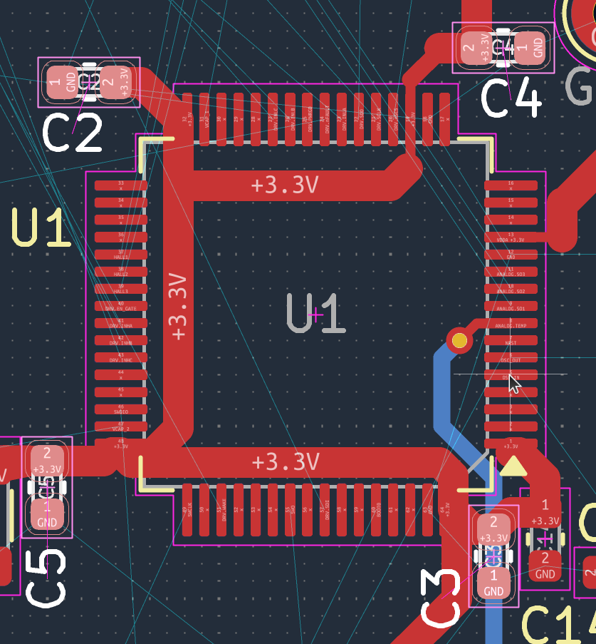
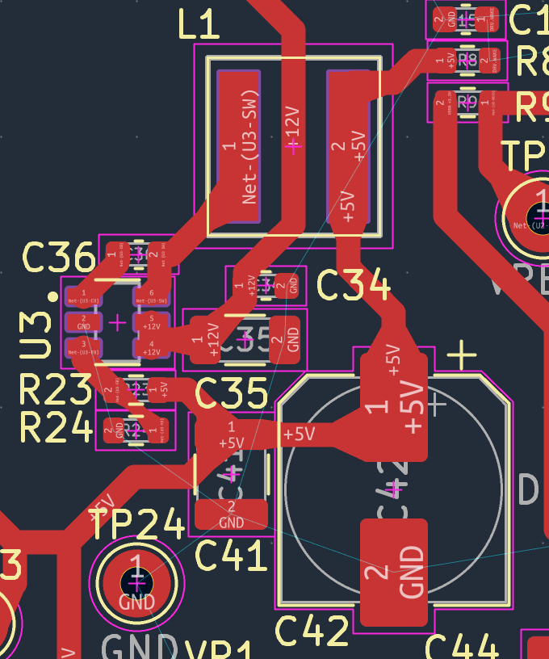

# Заняття 15: Електромагнітна сумісність (EMC/EMI)

**Опис завдання**

* Закінчити трасування плати.
* Залити Земляний полігон, зшити (Stitching) землі на різних шарах. 
* Якщо є BT-модуль зробити виріз полігону землі (cut-out) , відповідно до datasheet.
* Пройти DRC (Design Rule check)

## План завдання

### Вихідний стан (гілка `hw15`, після ДЗ 13–14)

DRC з `kicad-cli pcb drc --severity-all`: **0 порушень, 118 нерозведених з'єднань**.

| Мережі | Нерозведено | Лист |
|--------|-------------|------|
| `GND` | 60 | усі |
| `DRV.INHx/INLx`, `DRV.EN_GATE`, `DRV.WAKE`, `DRV.PWRGD`, `DRV.nFAULT` | 12 | Gate Driver |
| SPI `DRV.SCLK/SDI/SDO/nSCS` | 6 | Gate Driver |
| `ANALOG.SO1–3` | 6 | Gate Driver |
| Підкачка заряду та живлення U2: `CP1H/CP1L/CP2H/CP2L`, `VCP_LSD`, `VCPH`, `VREG`, `DVDD`, `AVDD`, `VDRAIN`, `C12` | 12 | Gate Driver |
| `NRST`, `BOOT0`, `OSC_IN/OSC_OUT`, `VCAP_1/2` | 11 | MCU |
| SWD `SWCLK/SWDIO/SWO` | 3 | MCU |
| `HALL1–3` | 3 | MCU |

Наявні полігони лежать тільки на F.Cu. Внутрішні шари In1.Cu/In2.Cu поки порожні. Стек - 4 шари.

**BT-модуля на платі немає.** У схемі немає радіомодулів і антен. Тому cut-out під антену не потрібен.

### Етапи

| № | Етап | Стан |
|---|------|------|
| 0 | Виправлення зауважень до 14 завдання | ✅ |
| 1 | Розподіл шарів і полігони GND | ⬜ |
| 2 | Трасування Gate Driver: підкачка заряду, живлення U2 | ⬜ |
| 3 | Трасування сигналів MCU <-> DRV8305: PWM, SPI, керування | ⬜ |
| 4 | Трасування `ANALOG.SO1–3` до АЦП | ⬜ |
| 5 | Трасування MCU: кварц, VCAP, NRST/BOOT0, SWD, HALL | ⬜ |
| 6 | Підключення GND: via до шару землі, силова земля | ⬜ |
| 7 | Stitching via та перевірка цілісності шару землі | ⬜ |
| 8 | BT cut-out — не застосовно | ➖ |
| 9 | DRC 0 / 0 нерозведених, ERC 0, `check-parallel.py` | ⬜ |
| 10 | Звіт, зображення, [`checklist.md`](checklist.md), [`pull-request.md`](pull-request.md) | ⬜ |

### 0. Виправлення зауважень до 13 - 14 завдань

- Змінюю параметри Minimum clearance з 0.1 на 0.2 мм та Minimun track width з 0.15 до 0.2 мм;
- Прибрав полігон +12M з GND виводів;

- Встановив decoupling (100n) конденсатори MCU безпосередньо біля ніжки живлення (C2 - 32 пін, C3 - 64 пін, C4 - 19 пін, C5 48 пін);

- Встановлюю вхідні конденсатори C34, C35 біля входів 5, 4 DC-DC перетворювача;

- LDO - лінію +5V спершу веду на конденсатор C43 потім на вхід - ніжку живлення 3 VR1;

### 1. Розподіл шарів і полігони GND

| Шар | Призначення |
|-----|-------------|
| F.Cu | компоненти, сигнали, силові полігони, заливка GND у вільних місцях |
| In1.Cu | **суцільний GND**, без доріжок і розрізів (опорний шар для F.Cu) |
| In2.Cu | GND-заливка, повільні сигнали (HALL, BOOT0) за потреби, острови `+3.3V`/`+5V` |
| B.Cu | сигнали, силові полігони ДЗ 13, заливка GND |

#### 1.1. Пріоритети полігонів

Зараз на F.Cu пріоритети 0–5 зайняті силовими полігонами: `PWR.SHC` = 0, `PWR.SHB` = 1,
`PWR.SHA` = 2, `+12M` = 3, `+12_FUSED` = 4, `+12_IN` = 5. Для додавання полігону `GND`
потрібно звільнити самий нижій пріорітер = 0.

- Піднімаю пріоритет кожного силового полігона F.Cu на 1 (0-->1 ... 5-->6).
- Залишаю для всіх майбутніх полігонів GND (F.Cu, In1.Cu, In2.Cu, B.Cu) — **пріоритет 0**.

#### 1.2. Параметри полігонів GND

| Параметр | In1.Cu | In2.Cu | F.Cu / B.Cu |
|----------|--------|--------|-------------|
| Мережа / контур | `GND`, уся плата по Edge.Cuts | `GND`, уся плата | `GND`, уся плата |
| Пріоритет | 0 | 0 (острови `+3.3V`/`+5V` — 1+) | 0 |
| Clearance | 0.3 мм | 0.3 мм | ≥ зазору класу `HIGH_CURRENT` (не менше 0.3 мм) |
| Min width | 0.25 мм | 0.25 мм | 0.25 мм |
| Pad connections | Thermal reliefs (на внутрішніх шарах це лише THT-пади: XT1, тестові точки) | як In1.Cu | Thermal reliefs |
| Thermal relief: spoke / gap | 0.5 / 0.3 мм | 0.5 / 0.3 мм | 0.4 / 0.3 мм |
| Remove islands | Always | Always | Always |

- Via KiCad завжди підключає до полігона суцільно, термобар'єр діє лише на пади —
  окремого правила для via не потрібно.
- **Винятки — силові GND-пади, суцільне підключення** (правило `gnd_power_solid` у `.kicad_dru` ✅):
  GND-пади шунтів R16/R19/R22, конденсаторів C25/C29/C32 і роз'єму XT1. Через них тече весь
  струм двигуна; термобар'єр зменшив би переріз міді (див. `high_current_zone_smd` з ДЗ 13).
- Відступ міді від краю плати: `min_copper_edge_clearance` = 0.5 мм уже задано в
  Board Setup → Constraints ✅.
- `min_connection` = 0.15 мм < Min width зони 0.25 мм ✅; clearance `HIGH_CURRENT` = 0.2 мм,
  тому 0.3 мм для GND на зовнішніх шарах з запасом ✅.
- Board Setup --> Board Editor Layers: In1.Cu — ім'я `In1.Cu (GND)`, тип `power` ✅.
  Канонічне ім'я `In1.Cu` лишається для правил `.kicad_dru` і `kicad-cli`; In2.Cu —
  тип `signal`, бо на ньому можливі сигнали.
