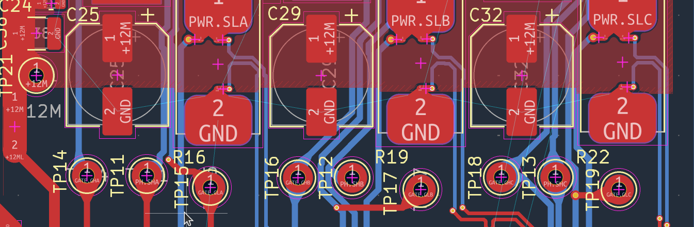
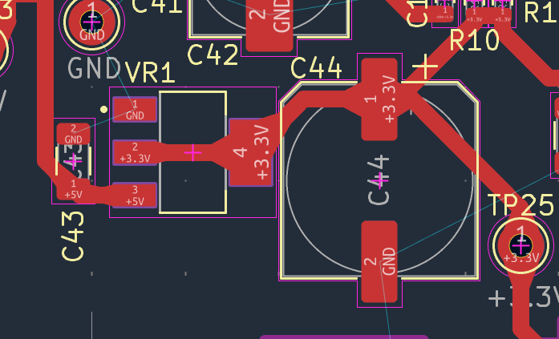

# Заняття 15: Електромагнітна сумісність (EMC/EMI)

**Опис завдання**

* Закінчити трасування плати.
* Залити Земляний полігон, зшити (Stitching) землі на різних шарах. 
* Якщо є BT-модуль зробити виріз полігону землі (cut-out) , відповідно до datasheet.
* Пройти DRC (Design Rule check)

## План завдання

### Вихідний стан (гілка `hw15`, після ДЗ 13–14)

DRC з `kicad-cli pcb drc --severity-all`: **0 порушень, 118 нерозведених з'єднань**.

| Мережі | Нерозведено | Лист |
|--------|-------------|------|
| `GND` | 60 | усі |
| `DRV.INHx/INLx`, `DRV.EN_GATE`, `DRV.WAKE`, `DRV.PWRGD`, `DRV.nFAULT` | 12 | Gate Driver |
| SPI `DRV.SCLK/SDI/SDO/nSCS` | 6 | Gate Driver |
| `ANALOG.SO1–3` | 6 | Gate Driver |
| Підкачка заряду та живлення U2: `CP1H/CP1L/CP2H/CP2L`, `VCP_LSD`, `VCPH`, `VREG`, `DVDD`, `AVDD`, `VDRAIN`, `C12` | 12 | Gate Driver |
| `NRST`, `BOOT0`, `OSC_IN/OSC_OUT`, `VCAP_1/2` | 11 | MCU |
| SWD `SWCLK/SWDIO/SWO` | 3 | MCU |
| `HALL1–3` | 3 | MCU |

Наявні полігони лежать тільки на F.Cu. Внутрішні шари In1.Cu/In2.Cu поки порожні. Стек - 4 шари.

**BT-модуля на платі немає.** У схемі немає радіомодулів і антен. Тому cut-out під антену не потрібен.

### Етапи

| № | Етап | Стан |
|---|------|------|
| 0 | Виправлення зауважень до 14 завдання | ✅ |
| 1 | Розподіл шарів і полігони GND | ✅ |
| 2 | Трасування Gate Driver: підкачка заряду, живлення U2 | ✅ |
| 3 | Трасування сигналів MCU <-> DRV8305: PWM, SPI, керування | ✅ |
| 4 | Трасування `ANALOG.SO1–3` до АЦП | ✅ |
| 5 | Трасування MCU: кварц, VCAP, NRST/BOOT0, SWD, HALL | ✅ |
| 6 | Підключення GND: via до шару землі, силова земля | ⬜ |
| 7 | Stitching via та перевірка цілісності шару землі | ⬜ |
| 8 | BT cut-out — не застосовно | ➖ |
| 9 | DRC 0 / 0 нерозведених, ERC 0, `check-parallel.py` | ⬜ |
| 10 | Звіт, зображення, [`checklist.md`](checklist.md), [`pull-request.md`](pull-request.md) | ⬜ |

### 0. Виправлення зауважень до 13 - 14 завдань

- Змінюю параметри Minimum clearance з 0.1 на 0.2 мм та Minimun track width з 0.15 до 0.2 мм;
- Прибрав полігон +12M з GND виводів;

- Встановив decoupling (100n) конденсатори MCU безпосередньо біля ніжки живлення (C2 - 32 пін, C3 - 64 пін, C4 - 19 пін, C5 48 пін);

- Встановлюю вхідні конденсатори C34, C35 біля входів 5, 4 DC-DC перетворювача;

- LDO - лінію +5V спершу веду на конденсатор C43 потім на вхід - ніжку живлення 3 VR1;

### 1. Розподіл шарів і полігони GND

| Шар | Призначення |
|-----|-------------|
| F.Cu | компоненти, сигнали, силові полігони, заливка GND у вільних місцях |
| In1.Cu | **суцільний GND**, без доріжок і розрізів (опорний шар для F.Cu) |
| In2.Cu | GND-заливка, повільні сигнали (HALL, BOOT0) за потреби, острови `+3.3V`/`+5V` |
| B.Cu | сигнали, силові полігони ДЗ 13, заливка GND |

#### 1.1. Пріоритети полігонів

Зараз на F.Cu пріоритети 0–5 зайняті силовими полігонами: `PWR.SHC` = 0, `PWR.SHB` = 1,
`PWR.SHA` = 2, `+12M` = 3, `+12_FUSED` = 4, `+12_IN` = 5. Для додавання полігону `GND`
потрібно звільнити самий нижій пріорітер = 0.

- Піднімаю пріоритет кожного силового полігона F.Cu на 1 (0-->1 ... 5-->6).
- Залишаю для всіх майбутніх полігонів GND (F.Cu, In1.Cu, In2.Cu, B.Cu) — **пріоритет 0**.

#### 1.2. Параметри полігонів GND

| Параметр | In1.Cu | In2.Cu | F.Cu / B.Cu |
|----------|--------|--------|-------------|
| Мережа / контур | `GND`, уся плата по Edge.Cuts | `GND`, уся плата | `GND`, уся плата |
| Пріоритет | 0 | 0 (острови `+3.3V`/`+5V` — 1+) | 0 |
| Clearance | 0.3 мм | 0.3 мм | ≥ зазору класу `HIGH_CURRENT` (не менше 0.3 мм) |
| Min width | 0.25 мм | 0.25 мм | 0.25 мм |
| Pad connections | Thermal reliefs (на внутрішніх шарах це лише THT-пади: XT1, тестові точки) | як In1.Cu | Thermal reliefs |
| Thermal relief: spoke / gap | 0.5 / 0.3 мм | 0.5 / 0.3 мм | 0.4 / 0.3 мм |
| Remove islands | Always | Always | Always |

- Via KiCad завжди підключає до полігона суцільно, термобар'єр діє лише на пади —
  окремого правила для via не потрібно.
- **Винятки — силові GND-пади, суцільне підключення** (правило `gnd_power_solid` у `.kicad_dru` ✅):
  GND-пади шунтів R16/R19/R22, конденсаторів C25/C29/C32 і роз'єму XT1. Через них тече весь
  струм двигуна; термобар'єр зменшив би переріз міді (див. `high_current_zone_smd` з ДЗ 13).
- Відступ міді від краю плати: `min_copper_edge_clearance` = 0.5 мм уже задано в
  Board Setup → Constraints ✅.
- `min_connection` = 0.15 мм < Min width зони 0.25 мм ✅; clearance `HIGH_CURRENT` = 0.2 мм,
  тому 0.3 мм для GND на зовнішніх шарах з запасом ✅.
- Board Setup --> Board Editor Layers: In1.Cu — ім'я `In1.Cu (GND)`, тип `power` ✅.
  Канонічне ім'я `In1.Cu` лишається для правил `.kicad_dru` і `kicad-cli`; In2.Cu —
  тип `signal`, бо на ньому можливі сигнали.

#### 1.3. Правила для шарів

- **In1.Cu** — додав заборону прокладати доріжки на цьому шарі; перевірено, працює
  (правило `in1_gnd_no_tracks` у `.kicad_dru` ✅).
- **In2.Cu** — на цей шар можливо перенесення чистин розводки `+3.3V`/`+5V` та повільні сигнали
 (HALL, BOOT0) лише за потреби під час трасування.
- **F.Cu / B.Cu** — розмістити мертві участки міді під U2, біля кварцу та RC-фільтрів CSA
  за допомогою Rule Area "No copper fill"; GND-заливка не повинна затікати між полігонами фаз —
  правило `gnd_zone_to_high_current`: зазор GND-заливки до силової міді ≥ 1 мм ✅.
- Не ділити землю на AGND/PGND розрізами. Розділення роблю розміщенням: силовий струм
  повернення тече під силовою частиною і не проходить під MCU та RC-фільтрами CSA.
- Під силовою частиною (Q1–Q6, шунти) In1.Cu лишається суцільним — це опора для струму
  повернення по контуру комутації. Антипади via 0.8/0.4 мм у силових масивах не повинні
  зливатися в щілину; якщо злилися — рознести via або зменшити clearance зони на In1.

Зроблено в рамках 1.3:

- Правило `u2_thermal_vias_solid` ✅: 25 via термопада U2 зʼєднані з GND на всіх шарах
  суцільно. До правила заливка B.Cu під U2 розпадалась на 16 квадратів, що зʼєднувались лише спицями.
- Rule Area «No copper fill» ✅: F.Cu — L1 (між падами SW / +5V), U3 (SW-вузол), Y1 (кварц),
  C43, R18; B.Cu — U3.
- Вузькі язики GND перевіряю скриптом `tools/check-gnd-tongues.py` (карта —
  [`images/gnd-tongues.png`](images/gnd-tongues.png)). Решту язиків — біля RC-фільтрів CSA
  (R14, TP4, TP13, TP18), смужку вздовж верхнього краю біля J5/XT1, смужки між доріжками —
  прибираю після трасування етапів 4–5 і stitching via етапу 7: доріжки там ще зміняться.

#### 1.4. Перевірка етапу

| Перевірка | Результат |
|-----------|-----------|
| DRC | **0 порушень** ✅ (зокрема `starved_thermal`, `in1_gnd_no_tracks`, `gnd_zone_to_high_current`) |
| Нерозведені `GND` | **14** замість 60 ✅ — решту закривають via на етапі 6 |
| Шматки заливки GND | In1.Cu — **1**, In2.Cu — **1**, B.Cu — **1**, F.Cu — 11 (острівці між компонентами; зшиваю via на етапах 6–7) |
| Силові GND-пади R16/R19/R22, C25/C29/C32, XT1 | суцільне підключення (`gnd_power_solid`) ✅; решта SMD — спиці термобарʼєра |
| In1.Cu під Q1–Q6 і шунтами | щілин від антипадів via немає ✅ |
| Отвори в In1.Cu / In2.Cu довші за 2 мм | монтажні отвори H1–H4, THT тестові точки, J5/XT1 — очікувано |

- Найбільший отвір в In1.Cu/In2.Cu — **12.7 мм під J5** (79.8–92.5, 59.9–64.1): антипади
  трьох THT-пінів фаз злились в одну щілину. Це край плати, струм повернення сигналів тут
  не тече, тому залишаю; на етапі 7 перевірити, що жодна сигнальна доріжка не перетинає щілину.
- Повторна перевірка In1.Cu на щілини — після етапів 2–6 (нові via) у межах етапу 7.

Нерозведені `GND` (етап 6): U1 — пади 18, 63; U2 — пад 45, термопад 49.x; C18, C24, C28, C31,
C38, R24, TH1, VD1.

### 2. Gate Driver: підкачка заряду та живлення U2

Вимоги datasheet DRV8305, розділ 10.1 Layout Guidelines:
- конденсатори 1 мкФ DVDD і AVDD — прямо до сусіднього виводу GND (DVDD 46 → GND 45,
  AVDD 15 → GND 14);
- конденсатори підкачки заряду CP1, CP2 0.047 мкФ — впритул до виводів;
- VCPH 2.2 мкФ і VCP_LSD 1 мкФ — близько, з прямим шляхом до GND;
- PVDD 4.7 мкФ — якомога ближче до виводу 41.

Уточнення до схеми:
- у DRV8305**N** вивід 48 VREG — **вхід VREF** (LDO немає), живиться від VDDA через R9 330 Ом.
  Конденсатора на VREG на платі не було — додано **C45 1 мкФ** біля виводу 48
  (R9 + C45 — RC-фільтр ≈ 480 Гц на опорі підсилювачів струму);
- `VDRAIN` — через R12 100 Ом від `+12ML`, тобто Kelvin-відвід від `+12M` через NT7.

Зроблено: конденсатори переставлено в два ряди біля лівого ряду виводів U2 (37–48), C20 —
праворуч біля виводів 14/15. Усі кола — доріжки 0.3 мм на F.Cu **без via**; GND C21 і C20 —
доріжкою до виводів 45 і 14, біля GND-падів C18, C20, C21, C45 — via 0.6 мм до In1.Cu (≈ 1.2 мм).
Термопад U2 — масив via з ДЗ 8/12, суцільне зʼєднання з полігонами — правило
`u2_thermal_vias_solid` (п. 1.3).

| Вивід U2 | Коло | Деталь | Відстань до виводу, мм (було → стало) |
|---|---|---|---|
| 46 | DVDD | C21 1 мкФ | 8.6 → **2.1** |
| 39 / 40 | CP2H / CP2L | C17 47 нФ | ~4 → 3.0 / 4.6 |
| 42 / 43 | CP1L / CP1H | C16 47 нФ | 9–10 → **3.6 / 5.2** |
| 48 | VREG (VREF) | C45 1 мкФ | — → **3.5** |
| 15 | AVDD | C20 1 мкФ | 4.5 → 3.6 |
| 38 | VCPH | C23 2.2 мкФ | 12.4 → **4.3** |
| 44 | VDRAIN | R12 100 Ом | 9 → 5.1 |
| 37 | VCP_LSD | C18 1 мкФ | 6.6 → 5.9 |
| 41 | PVDD `+12ML` | C22 4.7 мкФ | 8.2 → 6.1 |

Перевірка: DRC 0, schematic parity 0; кола CP1/CP2, VCPH, VCP_LSD, DVDD, AVDD, VDRAIN, VREG
розведені; нерозведених `GND` 10 (було 14 — підключено пади U2 45, 14 і C18).

Відкрите (необовʼязково, разом з етапом 7):
- C18 (VCP_LSD) — найдальший, 5.9 мм; підсунути до виводу 37, якщо звільниться місце;
- C22 — найближчий GND via 1.43 мм, між C22 і C23 язик заливки 4.2 мм² без via — додати via GND
  біля C22.2;
- дрібні язики біля C19/R8, C21/R9, C9/C20 (0.9–3.4 мм², `check-gnd-tongues.py`).

### 3. Сигнали MCU <-> DRV8305

Вимоги:
- PWM `DRV.INHA/INLA...INHC/INLC` — короткі, рівні групи, над суцільною землею, без переходу через
  розрізи землі. Біля кожного переходу шару — via GND поруч (≤ 1 мм) для струму повернення.
- Не вести PWM паралельно `ANALOG.SO1–3` і лініям `CS.SN_*` (правило з ДЗ 13).
- SPI (`SCLK/SDI/SDO/nSCS`) — групою, подалі від фазових вузлів `PH.SHx`.
- `nFAULT`, `PWRGD`, `WAKE`, `EN_GATE` — повільні, можна на B.Cu.

Розташування виводів: U2 — нижній ряд (1 EN_GATE … 12 SCLK, крок 0.5 мм), 13 PWRGD праворуч,
47 WAKE ліворуч; U1 — INH і EN_GATE на лівому боці (40–43), INL, SPI, nFAULT, PWRGD — на верхньому
(20–27), SDI (PB5, 57) і WAKE (PC10, 51) — на нижньому. Порядок виводів INH і INL на U1 зворотний
до U2, тому без via на одному шарі група не розводиться.

Шари: **сигнали лише на F.Cu і B.Cu, In1.Cu і In2.Cu не використано**. Стек сигнал / GND / GND /
сигнал: F.Cu має опорну землю In1, B.Cu — In2 (прошарок 0.1 мм); доріжка на внутрішньому шарі
прорізала б опорну землю обох сусідніх шарів.

Зроблено:
- PWM, EN_GATE і SPI — 22–27 мм, переважно F.Cu, перехрестя груп — короткі ділянки на B.Cu;
  SDI — по B.Cu під U1 до виводу 57 (33 мм); nFAULT, PWRGD, WAKE — F.Cu + B.Cu (45–53 мм).
  Ширина 0.3 мм (клас Default).
- `VDDA +3.3V` до R9 (VREF драйвера) — по B.Cu, 0.3 мм: струм ≤ 0.1 мА, внутрішній шар не потрібен.
- Наперед, разом з етапом 3, розведено `ANALOG.SO1–3` (етап 4), `HALL1–3` і `ANALOG.TEMP` (етап 5):
  - SO1–3 — 51–57 мм, переважно F.Cu; TP4–TP6 перенесено на саму трасу замість відводів 12–15 мм по B.Cu до шунтів;
  - HALL1–3 — по B.Cu вздовж правого краю і під U1; вузьку смужку заливки між
    трасою і краєм прибрано Rule Area `No GND_6` на B.Cu;
  - ANALOG.TEMP — по B.Cu лівою частиною плати, ≥ 4 мм від краю (164 мм; фільтр R15 + C26 ≈ 300 Гц
    біля АЦП); перший варіант по периметру (196 мм) лишав язик GND 81 мм уздовж краю.

Перевірка (копія плати з перезаливкою полігонів, `kicad-cli`):

| Перевірка | Результат |
|---|---|
| DRC / footprint / schematic parity | 0 / 0 / 0 |
| Нерозведені | 20 — лише етап 5 (кварц, NRST, BOOT0, SWD, VCAP_2) і GND R24, TP1, U1, VD1 |
| `check-parallel.py` (SH_, CS.SN ← GATE., PH.S, DRV.IN) | зазор < 1 мм — 0 |
| `check-parallel.py` (SO, TEMP, HALL ← DRV., PH.S, GATE.) | < 2 мм — лише TEMP <--> DRV.WAKE (див. нижче) |
| In1.Cu / In2.Cu | по одному суцільному шматку |
| Язики GND на B.Cu (`check-gnd-tongues.py`) | 31 мм², найбільший < 5 мм² (було 119 мм², 41 мм² уздовж краю) |

Відкладено на етап 7: via GND біля сигнальних via (зараз найближчий — 2–15 мм): насамперед INH*,
INLB/INLC, SO1/SO2, HALL; також via GND під U1 біля (93.5, 136), прибраний при перекладанні HALL.

### 4. Аналогові лінії `ANALOG.SO1–3`

Вимоги:
- Від виводів SO1–SO3 U2 (16–18, правий бік) до входів АЦП PC1–PC3 U1 (9–11, правий бік) —
  найкоротшим шляхом, на одному шарі, без via. RC-фільтрів на SO немає: R13–R21, C27/C30/C33 —
  це вхідні фільтри підсилювачів на лініях `CS.SN_*`, а не на виходах.
- Під лініями суцільна земля; по боках — GND-заливка з via (guard, via — на етапі 7).
- Відстань до PWM, фазових вузлів і затворів ≥ 3W; перетин з PWM тільки під 90° на іншому шарі.
- Подалі від `CS.SN_*` (входи підсилювачів, рівень мВ) і від `VDDA +3.3V` (опорна АЦП) — ≥ 3W.
- Без конденсатора безпосередньо на SO: максимальне ємнісне навантаження підсилювача без
  послідовного резистора — 60 пФ (DRV8305, CO_OPA). Фільтр перед АЦП, якщо знадобиться, —
  лише послідовний R 100–330 Ом + C біля U1.

Зроблено:
- **SO1 і SO3 поміняно місцями на входах MCU**: SO1 → PC3 (ADC3_IN13), SO3 → PC1 (ADC1_IN11),
  SO2 → PC2 без змін. Порядок виводів SO на U2 і PC1–PC3 на U1 зворотний, тому траса
  перехрещувалась через B.Cu (по 2 via на SO1 і SO2). Змінено схему (`mcu.kicad_sch`), `.ioc`,
  `main.h`, `stm32f4xx_hal_msp.c`; канали АЦП ті самі — змінилось лише, яку фазу міряє який АЦП
  (див. `design-notes.md`, таблиця АЦП).
- SO1–3 — 51–57 мм, **лише F.Cu, 0 via**, 0.3 мм; TP4–TP6 — на самій трасі (етап 3).
- SO2/SO3 відведено від `CS.SN_HC/LC` біля правого боку U2 (було ~12 мм паралельно із зазором
  0.2–0.7 мм) і від `VDDA` біля U1 (було ~9 мм із зазором 0.2 мм).
- Конденсаторів на SO немає. Навантаження: доріжка ~55 мм ≈ 8–10 пФ + TP + вивід і конденсатор
  вибірки АЦП ≈ 20 пФ < 60 пФ. Встановлення виходу — 300 нс при підсиленні 10 В/В; АЦП
  запускається injected від TIM1 TRGO, вибірка 15 тактів.

Перевірка (копія плати з перезаливкою полігонів):

| Перевірка | Результат |
|---|---|
| DRC / footprint / schematic parity, ERC | 0 / 0 / 0, ERC 0 |
| `check-parallel.py` SO, TEMP ← DRV., PH., GATE., HALL, MCU/ | зазор < 3 мм — 0 |
| `check-parallel.py` SO ← CS.SN, VDDA, +3.3V, +5V | < 1 мм — 4.9 мм, лише біля виводів U2 (нижче); `VDDA` — ≥ 2 мм |

Прийнято:
- SO3 <--> `CS.SN_HC` 0.2 мм і <--> `CS.SN_LC` 0.7 мм на ≤ 1.7 мм біля (90, 113.5) — вихід з виводів U2:
  SO3 (18) сусідить з SN3 (19), крок 0.5 мм. Ділянки біля `VDDA` біля U1 і між фільтрами CSA
  біля (100, 113) прибрано.
- SO1–3 ідуть групою з кроком 0.5 мм (зазор 0.2 мм): усі три — низькоомні виходи підсилювачів
  одного типу з однаковою смугою, взаємна завада між фазами незначна.

Відкладено на етап 7: via GND уздовж групи SO (guard) і біля TP4–TP6.

### 5. MCU

Вимоги:
- **Кварц** (ABLS 8 МГц): `OSC_IN/OSC_OUT` ≤ 5–10 мм, без via; навантажувальні конденсатори біля
  кварцу; під кварцом жодних сигналів на інших шарах; GND конденсаторів — via до In1.Cu.
- **VCAP_1/2** — 2.2 мкФ якомога ближче до виводів, GND через via одразу біля пада.
- **Розвʼязувальні 100 нФ** кожного VDD і **VDDA** — коротка петля вивід → C → via GND.
- **NRST, BOOT0** — короткі; конденсатор NRST біля MCU, а не біля кнопки.
- **SWD** (J1) — на F.Cu/B.Cu, подалі від кварцу. `HALL1–3` розведено на етапі 3.

Зроблено:

| Вузол | Було | Стало |
|---|---|---|
| C13 100 нФ (NRST, вивід 7) | 40 мм, біля SW1 | **4.0 мм** від виводу |
| C7 100 нФ (VDDA, вивід 13) | 12.9 мм, біля FL1 | **4.1 мм**, між VDDA і VSSA; C6 10 мкФ лишився біля FL1 |
| C10 2.2 мкФ (VCAP_2, вивід 47) | 6.5 мм, не розведено | 4.3 мм, доріжка 4.6 мм, F.Cu |
| C9 2.2 мкФ (VCAP_1, вивід 31) | 3.5 мм | без змін, доріжка 4.3 мм |
| Кварц Y1, C11, C12, R6 | не розведено | OSC_IN 10.9 мм, OSC_OUT 3.6 + 6.2 мм (через R6), лише F.Cu, 0 via; під Y1 — Rule Area `No GND_1` на F.Cu, на B.Cu доріжок немає, In1 суцільний |
| BOOT0 → R7 | — | 4.3 мм |
| SWCLK / SWDIO / SWO → J1 | — | 15.6 / 25.5 (F.Cu + B.Cu, 2 via) / 14.1 мм |
| NRST → SW1, TP2, J1 | — | 67 мм (повільний сигнал, фільтр C13 біля MCU) |
| GND-вивід 63 U1 | не розведено | підключено |
| Via GND біля GND-падів C1–C7, C9–C14 | 5–16 мм | **0.9–1.6 мм**; всього via GND на платі 86 (було 26) |

Перевірка (копія плати з перезаливкою полігонів):

| Перевірка | Результат |
|---|---|
| DRC / footprint / schematic parity | 0 / 0 / 0 |
| Нерозведені | 3 — лише GND: R24, VD1–C24 і острівець заливки F.Cu (етап 6) |
| In1.Cu / In2.Cu | по одному суцільному шматку |
| `check-parallel.py` OSC, NRST ← SO, DRV., SW, HALL, +3.3V | < 1 мм — лише NRST (нижче) |

Прийнято:
- NRST ↔ `ANALOG.SO3` 0.2 мм на 2.2 мм біля (104.8, 136.5) — підхід до виводів 7 і 9 U1;
  NRST ↔ SWO 0.54 мм на 2.8 мм. NRST майже не перемикається і тримається C13 100 нФ.
- OSC_OUT ↔ `ANALOG.SO3` 1.2 мм на 1.3 мм біля виводів U1.

Відкладено на етап 7: вузькі язики F.Cu біля U1 і Y1 (до 5 мм², більшість уже з via).
