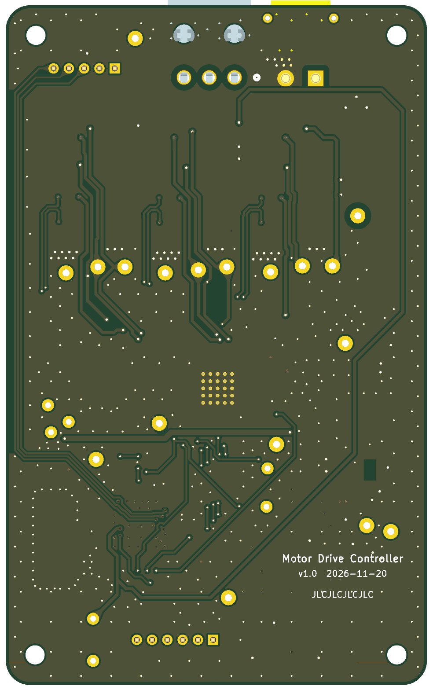
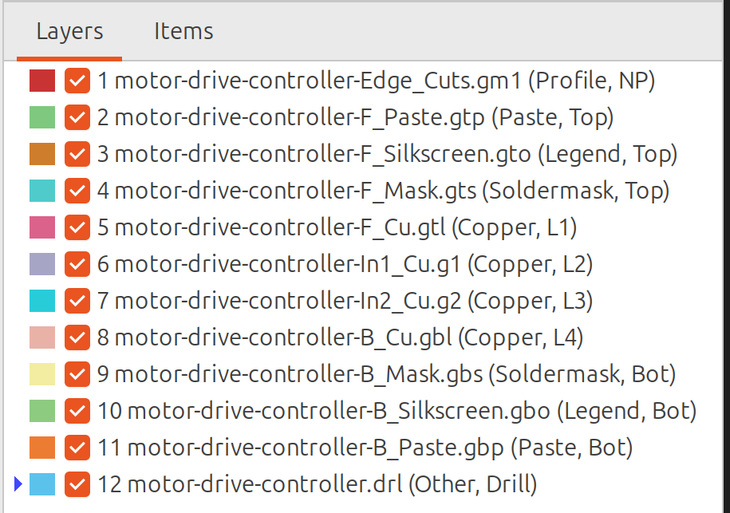
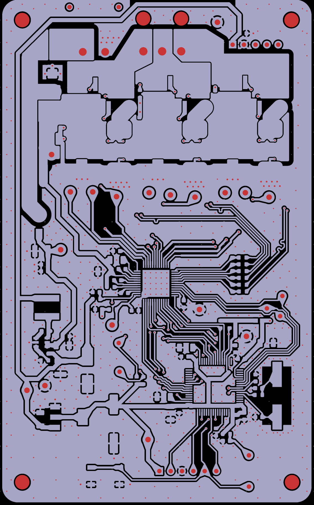
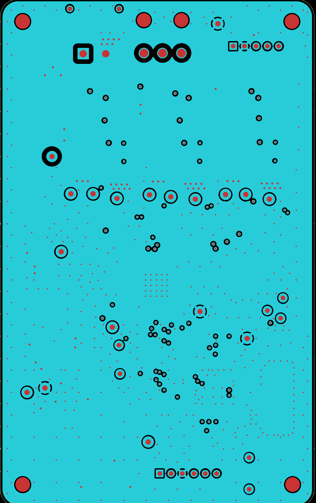
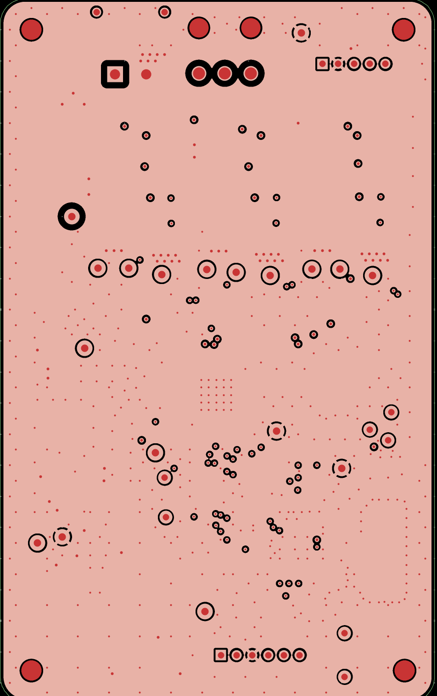
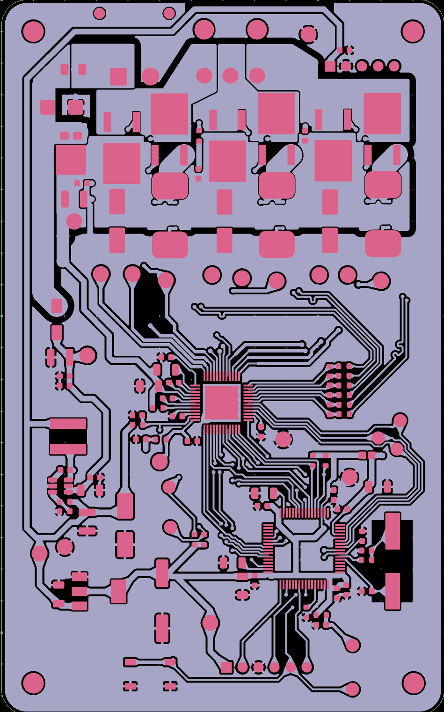
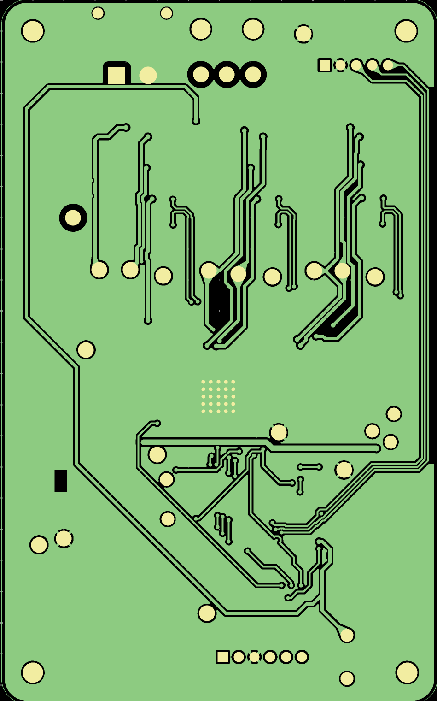
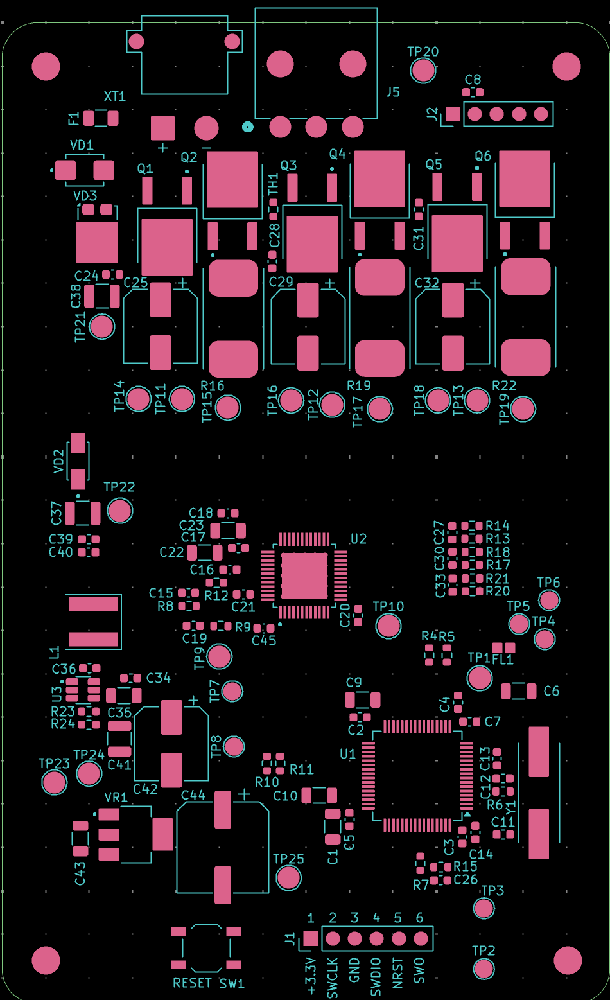
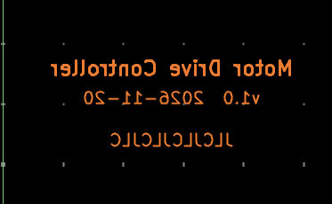
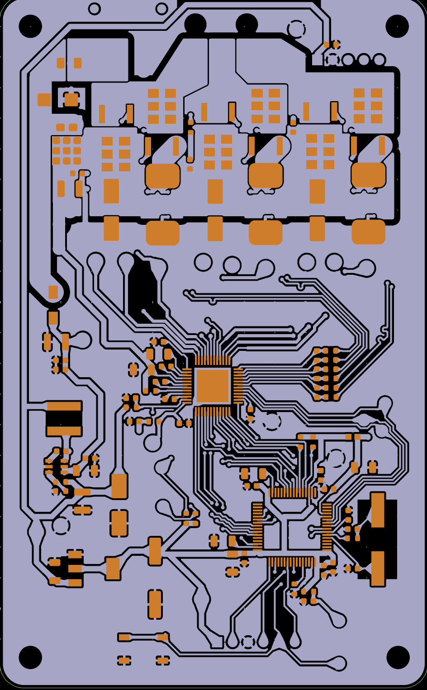

# Заняття 16: Підготовка файлів для виробництва

**Опис завдання**

* Підготувати виробничі файли проєкту:
  * Gerber-файли;
  * файл свердління.
* Оформити тестове замовлення друкованої плати на сервісі [JLCPCB](https://jlcpcb.com/) для перевірки файлів (без оплати).

## План завдання

### Вихідний стан (гілка `hw16`, після ДЗ 15)

- Плата 70 × 113 мм, 4 шари, DRC — 0 порушень, 0 нерозведених.
- Стек у KiCad: 1 oz зовні, 0.5 oz усередині, prepreg 0.0994 мм, core 1.265 мм — збігається
  зі стеком JLCPCB **JLC04161H-3313** (1.6 мм).
- Покриття `HAL SnPb` (HASL з свинцем), via закриті маскою (tenting) з обох боків.
- Мін. доріжка / зазор / отвір — 0.2 / 0.2 / 0.3 мм, кільце via — 0.15 мм. Усе це в межах
  можливостей JLCPCB для 4 шарів.
- Овальних отворів немає. NPTH — 6 (кріпильні M3 та ін.), PTH — 68 падів + via.
- На шовкографії немає назви плати, версії й дати, місця під номер замовлення JLCPCB теж немає.

### Етапи

| № | Етап | Стан |
|---|------|------|
| 0 | Виправлення зауважень до ДЗ 15 (якщо будуть) | ⬜ |
| 1 | Перевірка плати під можливості JLCPCB: правила DRC, стек, покриття | ✅ |
| 2 | Шовкографія: назва, версія, дата, місце під номер замовлення | ✅ |
| 3 | Налаштування та експорт Gerber | ✅ |
| 4 | Експорт файлу свердління (Excellon) | ✅ |
| 5 | Автоматизація: `make fab` і CI-артефакт з архівом для виробництва | ✅ |
| 6 | Перевірка Gerber у Gerber Viewer | ⬜ |
| 7 | Тестове замовлення на JLCPCB (без оплати) | ⬜ |
| 8 | Звіт, зображення, `checklist.md`, `pull-request.md` | ⬜ |

### 1. Перевірка під можливості JLCPCB

Правила плати (Board Setup --> Constraints) і фактичні пади/via порівняно з
[JLCPCB PCB Capabilities](https://jlcpcb.com/capabilities/pcb-capabilities), рядки для
4 шарів, 1 oz:

| Параметр | JLCPCB, мін. | Правило плати | Фактично на платі |
|----------|--------------|---------------|-------------------|
| Доріжка / зазор | 0.09 / 0.09 мм | 0.2 / 0.2 мм | ≥ 0.2 / ≥ 0.2 мм |
| Зазор SMD-пад — пад, різні мережі | 0.15 мм | 0.2 мм | ≥ 0.2 мм |
| Отвір via / діаметр via | 0.15 / 0.25 мм | 0.3 / 0.5 мм | 0.3/0.6 і 0.4/0.8 мм |
| Кільце PTH і via | 0.15 мм (рекоменд. 0.2) | **0.1 --> 0.15 мм** | ≥ 0.15 мм (via 0.6/0.3, пади U2) |
| Металізований отвір | 0.15 … 6.3 мм | ≥ 0.3 мм | 0.3 … 1.85 мм |
| Неметалізований отвір (NPTH) | 0.5 мм | **нове правило 0.5 мм** | 3.048 і 3.2 мм |
| Отвір — отвір (пади) | 0.45 мм | 0.5 мм, **warning --> error** | DRC 0 |
| Отвір — мідь (PTH до доріжки) | 0.28 мм | 0.3 мм | DRC 0 |
| Мідь — край плати | 0.2 мм | 0.5 мм | DRC 0 |
| Перемичка маски (зелена) | 0.1 мм | **0.1 --> 0** (див. етап 3) | ≈ 0.2 мм між падами з кроком 0.5 |
| Розширення маски | 1:1 | 0 мм | — |
| Шовкографія: лінія / висота тексту | 0.15 / 1.0 мм | 0.15 / 1.0 мм | DRC 0 |
| Шовкографія — пад | 0.15 мм | 0.15 мм | DRC 0 |
| Товщина плати | 1.6 мм ± 10 % | стек 1.58 мм | — |

Зміни:
- `min_via_annular_width` 0.1 --> 0.15 мм. Значення 0.1 мм нижче абсолютного мінімуму
  JLCPCB. Плата вже відповідала новому правилу, нічого не переробляли.
- Зазор класів мереж Default, KELVIN_LINE і Supply 0.15 --> 0.2 мм. Раніше діяв загальний
  мінімум плати 0.2 мм, тепер класи йому не суперечать.
- Перевірка `hole_to_hole` з warning стала error: близькі отвори — брак свердління,
  а не косметика.
- У `motor-drive-controller.kicad_dru` додано правило `jlc_npth_min_hole`: NPTH ≥ 0.5 мм.
  Загальний мінімум отвору 0.3 мм для неметалізованих отворів недостатній. Правило
  перевірено: при тимчасовому мінімумі 4 мм DRC позначив усі NPTH 3.2 мм.

Покриття — **HASL with lead** (`HAL SnPb` у стеку плати, вже стоїть), найдешевший варіант.
JLCPCB дозволяє HASL для FR-4 до 4 шарів включно. Плата не має дрібного кроку
(найменший — LQFP-64 STM32 і HTQFP DRV8305, 0.5 мм), тож рівність ENIG не потрібна.

DRC після змін (`kicad-cli pcb drc --refill-zones --schematic-parity --severity-all`):
**0 порушень, 0 нерозведених, 0 розбіжностей зі схемою.**

### 2. Шовкографія

Усі 122 компоненти стоять на F.Cu, низ плати вільний. Тому маркування поставлено на
**B.SilkS**, у правий нижній кут (якщо дивитися знизу), де немає падів і тестових точок.

- Title block плати (File --> Board Setup --> Title Block): назва `Motor Drive Controller`,
  версія `1.0`, дата `2026-11-20`.
- Тексти посилаються на змінні, тож для нової версії досить змінити title block:

  | Текст | Розмір / товщина |
  |-------|------------------|
  | `${TITLE}` | 1.2 / 0.2 мм |
  | `v${REVISION}  ${ISSUE_DATE}` | 1.0 / 0.15 мм |
  | `JLCJLCJLCJLC` — місце номера замовлення | 1.0 / 0.15 мм |

- Тексти на нижньому шарі дзеркальні (`justify mirror`), щоб читалися з боку низу.
- У замовленні треба вибрати *Remove Mark --> Specify a location*: JLCPCB надрукує номер на
  місці `JLCJLCJLCJLC`, а не в довільному місці.



DRC після змін: **0 порушень, 0 нерозведених, 0 розбіжностей зі схемою.**

### 3. Gerber

Plot (File --> Fabrication Outputs --> Gerbers), як рекомендує JLCPCB для KiCad:

| Параметр | Значення | Чому |
|----------|----------|------|
| Шари | F.Cu, In1.Cu, In2.Cu, B.Cu, F/B.Silkscreen, F/B.Mask, F/B.Paste, Edge.Cuts | Fab, Courtyard, User.* заводу не потрібні |
| Output directory | `../../../build/hardware/manufacturing/gerber/` | `build/` у `.gitignore`, згенеровані файли не потрапляють у git |
| Subtract soldermask from silkscreen | так | фарба не ляже на відкриті пади |
| Drill marks / Scaling | None / 1:1 | |
| Use drill/place file origin | ні | абсолютні координати, як у drill-файлах |
| Check zone fills before plotting | так | Gerber бере збережену заливку |
| Use Protel filename extensions | так | JLCPCB визначає шар за розширенням |
| Use extended X2 format | ні | рекомендація JLCPCB для KiCad |
| Generate Gerber job file | так | `.gbrjob` описує стек і призначення файлів |
| Coordinate format | 4.6, мм | |

**Мінімальна перемичка маски 0.1 --> 0 мм** (Board Setup --> Solder Mask/Paste). KiCad
попереджав у діалозі Plot: з ненульовим значенням він сам зливає вікна маски, ближчі за
0.1 мм, прямо в Gerber. Завод отримує вже змінену маску й не може застосувати свої
правила. Маска тепер 1:1 з падами. Між падами з кроком 0.5 мм (STM32, DRV8305) лишається
≈ 0.2 мм, удвічі більше за мінімум JLCPCB.

**Користувацьку назву шару `In1.Cu (GND)` прибрано**: KiCad підставляє її в ім'я файлу,
і виходило `motor-drive-controller-In1_Cu (GND).g1` — з пробілом і дужками.

Налаштування зберігаються в `pcbplotparams` у `.kicad_pcb`. Для автоматизації
(етап 5) їх продубльовано явними опціями `kicad-cli`.

Результат — 12 файлів:

| Файл | Шар (атрибут `FileFunction`) |
|------|------------------------------|
| `motor-drive-controller-F_Cu.gtl` | Copper, L1, Top |
| `motor-drive-controller-In1_Cu.g1` | Copper, L2, Inr |
| `motor-drive-controller-In2_Cu.g2` | Copper, L3, Inr |
| `motor-drive-controller-B_Cu.gbl` | Copper, L4, Bot |
| `motor-drive-controller-F_Silkscreen.gto` / `B_Silkscreen.gbo` | Legend Top / Bot |
| `motor-drive-controller-F_Mask.gts` / `B_Mask.gbs` | Soldermask Top / Bot |
| `motor-drive-controller-F_Paste.gtp` / `B_Paste.gbp` | Paste Top / Bot |
| `motor-drive-controller-Edge_Cuts.gm1` | Profile |
| `motor-drive-controller-job.gbrjob` | 4 шари, 70.05 × 113.05 мм, 1.584 мм, `HAL SnPb`, rev 1.0 |

Перевірено: X2-атрибутів у файлах немає (лише коментарі `G04 #@!`), формат координат
`FSLAX46Y46`, одиниці мм.

### 4. Файли свердління

File --> Fabrication Outputs --> Drill Files:


| Параметр | Значення | Чому |
|----------|----------|------|
| Output folder | `../../../build/hardware/manufacturing/gerber/` | разом із Gerber, увесь комплект — один zip |
| Формат | Excellon | стандарт для свердлильних верстатів |
| Mirror Y axis / Minimal header | ні / ні | повний заголовок: одиниці й формат указані явно |
| PTH and NPTH in single file | так | один файл, неметалізовані свердла позначені атрибутом `NonPlated` |
| Use alternate drill mode for oval holes | так | рекомендація JLCPCB. Овальних отворів на платі немає |
| Origin / Units / Zeros | Absolute / мм / Decimal | так само, як Gerber, отвори не зсуваються відносно міді |
| Generate map | ні | карта — креслення для людини, заводу не потрібна |

Діаметри в Excellon фінішні (після металізації), припуск JLCPCB додає сам.

Результат:

| Файл | Свердла, мм (кількість отворів) | Разом |
|------|---------------------------------|-------|
| `motor-drive-controller.drl`, металізовані (T1–T7) | 0.3 via (534), 0.3 термо-via U2 (25), 0.4 via (89), 1.0 (20), 1.2 (18), 1.7 (2), 1.854 (3) | 691 |
| `motor-drive-controller.drl`, неметалізовані (T8–T9) | 3.048 (2), 3.2 (4) | 6 |
| `motor-drive-controller-drl.rpt` | звіт зі списком свердел (Generate Report File, у zip не йде) | |

Заголовок файлу — `FileFunction,MixedPlating`. Перед свердлами T8 і T9 стоїть
`TA.AperFunction,NonPlated,NPTH`: так завод дізнається, що ці отвори не металізуються.

Альтернатива — окремі `-PTH.drl` і `-NPTH.drl`. Тоді неметалізовані отвори позначені
самим файлом, а не коментарем, і це надійніше, якщо CAM-програма заводу ігнорує
коментарі. JLCPCB приймає обидва варіанти. Наслідок помилки для цієї плати некритичний:
6 отворів M3 стали б металізованими й трохи меншими.

Два свердла по 0.3 мм KiCad розділив за призначенням: ViaDrill і ComponentDrill.
Діаметр однаковий, тож завод зробить їх одним свердлом.

Перевірка:
- Кількість отворів збігається з платою: 623 via + 68 падів = 691 PTH, 6 NPTH.
- Координати кожного з 691 PTH збігаються з центром пада на всіх 4 шарах міді в межах
  1 мкм. Більшої точності не дає формат: drill 3:3 — 1 мкм, Gerber 4.6 — 1 нм.
- Усі 6 NPTH мають вікна в масці з обох боків. Міді навколо них немає, як і має бути
  для кріпильних отворів.

### 5. Автоматизація

Ручний експорт з етапів 3–4 повторено в [`tools/kicad-outputs.sh`](../../tools/kicad-outputs.sh).
Структура результату:

```
build/hardware/
├── motor-drive-controller-erc.rpt
├── motor-drive-controller-schematic.pdf
└── manufacturing/                          <-- усе для виробництва
    ├── gerber/                             <-- Gerber і Excellon (.drl)
    ├── assembly/                           <-- BOM і позиції компонентів (.csv)
    │   ├── motor-drive-controller-bom.csv
    │   └── motor-drive-controller-all-pos.csv
    └── motor-drive-controller-fab.zip      <-- вміст gerber/, завантажується на JLCPCB
```

| Команда | Результат |
|---------|-----------|
| `make fab` | лише `manufacturing/` |
| `make hardware` | ERC, схема PDF і `manufacturing/` |

- `kicad-cli pcb export gerbers`: ті самі 11 шарів і опції, що в діалозі Plot
  (`--no-x2 --subtract-soldermask`, Protel-розширення й job-файл за замовчуванням).
- `kicad-cli pcb export drill`: Excellon, мм, decimal, absolute, PTH і NPTH
  в одному файлі, alternate drill mode, без карти.
- `--check-zones` перезаливає полігони перед експортом. Без нього CLI бере заливку,
  збережену у файлі, а вона може бути застарілою.
- `kicad-cli pcb export pos`: позиції лише SMD-компонентів (`--smd-only`), обидві сторони,
  мм, без DNP. THT-роз'єми, тестові точки й кріпильні отвори паяються вручну. Файл
  збігається з експортом з KiCad (File --> Fabrication Outputs --> Component Placement).
- Папка `manufacturing/gerber/` щоразу очищується, щоб у zip не потрапили старі файли,
  як-от `In1_Cu (GND).g1` з етапу 3.
- Плата без контуру Edge.Cuts пропускається: порожня `stepper-motor.kicad_pcb` у
  `prototypes/` не ламає CI.
- CI вже запускає `kicad-outputs.sh` для кожного проєкту, тож zip потрапляє в артефакти
  PR і в Release за тегом `hw16`. Release отримує всі файли, крім `manufacturing/gerber/`:
  вони вже є в zip.

Чому не `--board-plot-params`: у kicad-cli 10.0.5 з цим прапорцем X2 лишається
увімкненим, хоча в платі він вимкнений, а `--no-x2` разом із ним ігнорується. Тому шари
й опції задано явно.

Перевірка: файли з `make fab` порівняно з ручним експортом з етапів 3–4. Усі шари,
drill-файл і job-файл збігаються до рядка, крім дати створення. Різниться лише
F.Cu: заливку полігонів перераховано заново, і дуги розбито на відрізки інакше, у межах
похибки апроксимації 5 мкм.

### 6. Перевірка Gerber

- Командою `make hardware` згенерував всі файли по проекту:

```bash
$ make hardware

tools/kicad-outputs.sh motor-drive-controller/hardware/kicad
Found 0 violations
Saved ERC Report to build/hardware/motor-drive-controller-erc.rpt
Plotted to 'build/hardware/motor-drive-controller-schematic.pdf'.
Done.
Wrote bill of materials to 'build/hardware/manufacturing/assembly/motor-drive-controller-bom.csv'.
Plotted to 'build/hardware/manufacturing/gerber/motor-drive-controller-F_Cu.gtl'.
Plotted to 'build/hardware/manufacturing/gerber/motor-drive-controller-In1_Cu.g1'.
Plotted to 'build/hardware/manufacturing/gerber/motor-drive-controller-In2_Cu.g2'.
Plotted to 'build/hardware/manufacturing/gerber/motor-drive-controller-B_Cu.gbl'.
Plotted to 'build/hardware/manufacturing/gerber/motor-drive-controller-F_Paste.gtp'.
Plotted to 'build/hardware/manufacturing/gerber/motor-drive-controller-B_Paste.gbp'.
Plotted to 'build/hardware/manufacturing/gerber/motor-drive-controller-F_Silkscreen.gto'.
Plotted to 'build/hardware/manufacturing/gerber/motor-drive-controller-B_Silkscreen.gbo'.
Plotted to 'build/hardware/manufacturing/gerber/motor-drive-controller-F_Mask.gts'.
Plotted to 'build/hardware/manufacturing/gerber/motor-drive-controller-B_Mask.gbs'.
Plotted to 'build/hardware/manufacturing/gerber/motor-drive-controller-Edge_Cuts.gm1'.
Created file 'build/hardware/manufacturing/gerber/motor-drive-controller.drl'
Done.
/home/andrii/Projects/hd/build/hardware/manufacturing/gerber
Wrote position data to 'build/hardware/manufacturing/assembly/motor-drive-controller-all-pos.csv'.
...
build/hardware/manufacturing/gerber/motor-drive-controller-job.gbrjob
build/hardware/manufacturing/motor-drive-controller-fab.zip
build/hardware/motor-drive-controller-erc.rpt
build/hardware/motor-drive-controller-schematic.pdf
```

Відкрив архів `build/hardware/manufacturing/motor-drive-controller-fab.zip` у KiCad Gerber Viewer
і в архіві файл `motor-drive-controller-job.gbrjob` (додатково відкрив файл `motor-drive-controller.drl`):

- [x] усі 11 шарів на місці + 1 файл для свердлення отворів;

  

- [x] контур плати `Edge.Cuts` замкнений з закругленими кутами, розмір 70 на 113 мм;
- [x] отвори співпадають з via та роз'ємами;

  

- [x] `In1.Cu` та `In2.Cu` суцільна земля з кільцями-вирізами навколо via інших мереж. Доріжок немає;

   

- [x] `F.Mask` + `F.Cu` вікна в масці лише над падами. Via закриті, вікон над ними немає (tenting);

  

- [x] `B.Mask` вікна лише над THT-падами, тестовими точками й NPTH;

  

- [x] `F.Silkscreen` + `F.Mask` позначення R1, C5… не заходять у вікна маски. Їх обрізано опцією Subtract soldermask;

  

- [x] `B.Silkscreen` назва, v1.0 2026-11-20, JLCJLCJLCJLC. Зверху текст виглядає дзеркальним;

  

- [x] `F.Paste` вікна пасти лише на SMD-падах. На THT-падах і тестових точках пасти немає;

  

- [x] `B.Paste` порожній, бо знизу немає компонентів;
- [x] маска й шовкографія не зсунуті;
- [x] кількість і діаметри отворів у drill-файлі з Board Statistics співпадають.
