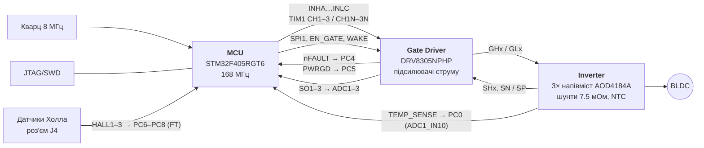
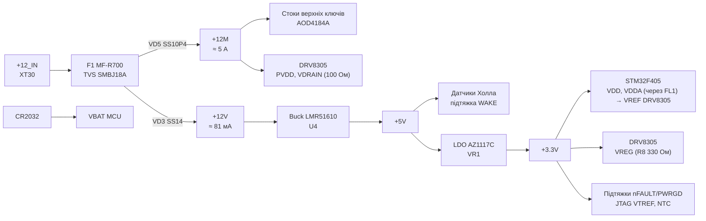

# Архітектура

Стан схеми після ДЗ 10. Аркуші MCU, Gate Driver, Inverter, Power; відкриті
питання — у [`design-notes.md`](design-notes.md#відкриті-питання).

## Сигнали

Між листами сигнали йдуть ієрархічними шинами (`DRV{…}`, `GATE{GATE6}`,
`PH{SENSE6}`, `CS{SHUNT6}`, `ANALOG{AIN4}`), див. [README проєкту](../README.md).

## Живлення

Шини +12M (двигун) і +12V (логіка) розв'язані діодами Шотткі: струм гальмування
двигуна не потрапляє на живлення логіки. LDO після buck прибирає пульсації з VDDA
(опорна АЦП і VREF драйвера).

## Ключові рішення

| Вузол | Рішення | Обґрунтування |
|-------|---------|---------------|
| Силові ключі | AOD4184A, 40 В / 50 А, 5.8 мОм, TO-252 | [ДЗ 6](../../assignments/homework_06/README.md) |
| Шунти | WSR57L500FEA, 7.5 мОм, 5 Вт | [ДЗ 6](../../assignments/homework_06/README.md) |
| MCU | STM32F405RGT6: TIM1 з комплементарним ШІМ і dead-time, 3 ADC | [ДЗ 7](../../assignments/homework_07/README.md) |
| Тактування | HSE 8 МГц (AAH-181), Cext = 30 пФ, PLL → 168 МГц | [ДЗ 7](../../assignments/homework_07/README.md) |
| Драйвер затворів | DRV8305NPHP (без LDO): вбудовані підсилювачі струму, SPI | [ДЗ 8](../../assignments/homework_08/README.md), [ДЗ 9](../../assignments/homework_09/README.md) |
| Датчики Холла | PC6–PC8: FT-піни, водночас TIM3_CH1–CH3 (апаратний інтерфейс Холла) | [ДЗ 8](../../assignments/homework_08/README.md) |
| Вхідний захист | PTC MF-R700 (7 А), TVS SMBJ18A, Шотткі SS10P4 (+12M) / SS14 (+12V) | [ДЗ 10](../../assignments/homework_10/README.md) |
| +5V / +3.3V | buck LMR51610 (1 А, 400 кГц) → LDO AZ1117C (0.8 А) | [ДЗ 10](../../assignments/homework_10/README.md) |

Детально — у [`design-notes.md`](design-notes.md).

## Вимоги

| Параметр | Значення | Джерело |
|----------|----------|---------|
| Напруга живлення | 12 В | ДЗ 6 |
| Потужність двигуна з навантаженням | 168 Вт (~14 А) | ДЗ 6 |
| Запас ключів за струмом / напругою | ≥ 1.5–2× / ≥ 1.5–2× (комфортно 3×) | ДЗ 6 |
| Максимальна напруга сигналу струму на вході АЦП | 3.3 В | ДЗ 6 |
| Підсилення сигналу струму | 20 В/В (задається в DRV8305 через SPI) | ДЗ 6, 8 |
| Живлення логіки драйвера | +3.3V; VDRAIN — від +12M | ДЗ 8 |
| Струм двигуна для блоку живлення | 5 А (двигун замінено на менш потужний) | ДЗ 10 |
